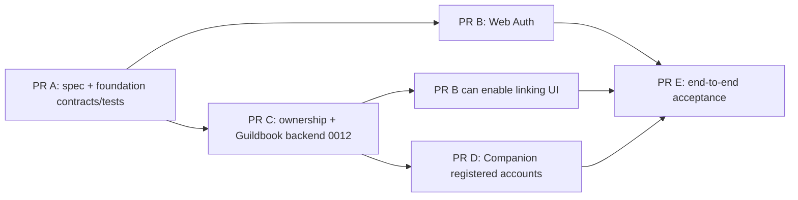

# ForeverDB Account System V1

One Supabase Auth identity, used by the website and the Windows Companion, with **independent sessions**, and verified ownership of Companion installations. Public loot browsing stays anonymous. Anonymous Companion collection and sync keep working unchanged.

**Target outcome:** UNIFIED ACCOUNT SYSTEM V1 IMPLEMENTED AND VERIFIED IN ISOLATED DEVELOPMENT/STAGING, WITH PRODUCTION ACTIVATION EXPLICITLY BLOCKED UNTIL OWNER APPROVAL.

| Document | Content |
| --- | --- |
| [architecture.md](architecture.md) | Audit of the actual `main`, data flows, trust boundaries, the Auth-boundary decision (options evaluated), web session design, environments |
| [ownership-claim-protocol.md](ownership-claim-protocol.md) | Claim and session state machines, private schema, function contracts, concurrency, failure and recovery, migration `0012` plan, rollback |
| [security.md](security.md) | Account-specific threat model, abuse prevention, negative-test matrix mapped to the 20 mandatory tests |
| [acceptance-and-owner-actions.md](acceptance-and-owner-actions.md) | Evidence ledger rules, per-PR acceptance, the owner action checklist (the things only the owner can do or approve) |

Related: [ADR-015..018](../web/architecture-decisions.md), [web threat model](../web/threat-model.md), [go-live checklist](../web/go-live-checklist.md), [release gates](../web/release-gates.md), [ROADMAP](../ROADMAP.md).

## Scope

In scope (V1): email/password registration, email verification, login/logout, password recovery, secure session refresh and expiry, minimal profile, list of verified linked installations, installation linking, private Guildbook access limited to owned installations; Companion registered sign-in, claim generation and display, session-state handling, sync pause/resume around ownership changes.

Out of scope: higher registered quotas (current anonymous and registered quota limits are preserved), cross-account transfers, account merges, social/OAuth/MFA logins, any public-database work, publication migration `0010`, production activation.

## Decisions at a glance

1. **Shared identity, isolated data.** The existing private Supabase Auth is the only identity provider; the separate public PostgreSQL is untouched. No second user database.
2. **Auth-only web boundary (ADR-015):** an isolated `/account` route group plus `/api/account/*`, a server-side backend-for-frontend using the *publishable* key and the *user's own* JWT. A closed allowlist of Auth endpoints and of database RPCs. No service-role credential, no database driver, no generic forwarding, no tokens in browser JavaScript.
3. **Narrow, separately validated Auth configuration (ADR-016):** `ACCOUNT_AUTH_MODE=disabled|local|staging|production`. `production` is hard-blocked in V1 by a code constant; `staging` never targets the private production project or Vercel's production target. The global private-project guard is unchanged. Implemented and tested in PR A (`web/src/lib/account/config.ts`).
4. **Ownership by single-use claim code (ADR-017):** the Companion's current owner (typically an anonymous UID) requests a 128-bit single-use code (10 minutes, hash only stored); a verified registered user redeems it; ownership moves in one transaction guarded by the same advisory lock the ingest function uses. An installation ID alone proves nothing.
5. **Companion fails closed (ADR-018):** a registered session never falls back to a new anonymous identity; explicit session kinds; atomic DPAPI persistence with a plaintext kind marker so a corrupt registered session cannot silently degrade to anonymous.
6. **Registered quotas unchanged.** One registered UID shares today's per-UID budgets across its installations; that limitation is documented, not "fixed" in V1.

## PR plan and dependencies

| PR | Branch (planned) | Delivers | Needs before merge |
| --- | --- | --- | --- |
| **A** | `account/v1-spec-foundation` | This specification set, ADR-015..018, threat model, account-auth configuration validator, closed RPC/endpoint/redirect contracts, claim-code format, static boundary tests | independent architecture + security review |
| **B** | `account/v1-web-auth` | Registration, verification, login/logout, recovery, session management, profile; CI job with a real isolated Auth stack and captured email | A merged; no ownership or Guildbook access yet |
| **C** | `account/v1-ownership-backend` | Forward-only migration `0012` (claims, links, audit, account RPCs), SQL integration suite, negative authorization matrix | A merged; owner approval only needed later to *apply* anywhere real |
| **D** | `account/v1-companion` | WPF sign-in, session states, claim display, DPAPI hardening, regression suite, new alpha build (`0.9.0-alpha`) | C's contract; Windows CI |
| **E** | `account/v1-acceptance` | Cross-component acceptance, real Windows + web evidence, documentation completion | B, C, D merged; owner-provided isolated staging |

Each PR is independently reviewable, ends with an independent security review and is **never merged automatically**. B, C and D can proceed in parallel after A; B's linking UI and D's claim flow depend on C's function contracts (already frozen in PR A).

## Evidence ledger (current)

Legend: **IMPLEMENTED** (code in the PR) · **CI VERIFIED** (GitHub Actions on the final head) · **STAGING VERIFIED** (isolated real Supabase Auth + Postgres) · **WINDOWS VERIFIED** (real Windows Companion) · **PRODUCTION APPROVED** (owner) · **BLOCKED / PENDING**.

| Capability | State | Evidence |
| --- | --- | --- |
| Specification, ADRs, threat model | IMPLEMENTED (PR A) | this directory |
| Account Auth configuration validator + closed contracts + boundary tests | IMPLEMENTED (PR A); CI VERIFIED when PR A checks pass | `web/src/lib/account/`, `web/tests/unit/account-*.test.ts` |
| Web registration, verification, login, recovery | BLOCKED / PENDING (PR B) | — |
| Ownership claim backend, account Guildbook RPCs | BLOCKED / PENDING (PR C) | — |
| Companion registered accounts | BLOCKED / PENDING (PR D) | — |
| Real Auth/email/two-account acceptance | BLOCKED / PENDING (needs owner staging, PR E) | — |
| Any production activation | BLOCKED (no owner approval; code constant false) | — |

No capability is called complete on mocks alone; see [acceptance-and-owner-actions.md](acceptance-and-owner-actions.md).
