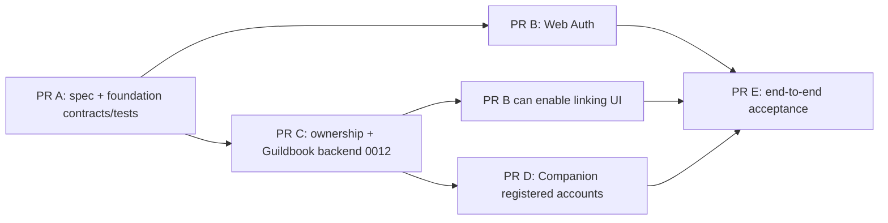

# ForeverDB Account System V1

One Supabase Auth identity, used by the website and the Windows Companion, with **independent sessions**, and verified ownership of Companion installations. Public loot browsing stays anonymous. Anonymous Companion collection and sync keep working unchanged.

**Target outcome:** UNIFIED ACCOUNT SYSTEM V1 IMPLEMENTED AND VERIFIED IN ISOLATED DEVELOPMENT/STAGING, WITH PRODUCTION ACTIVATION EXPLICITLY BLOCKED UNTIL OWNER APPROVAL.

| Document | Content |
| --- | --- |
| [architecture.md](architecture.md) | Audit of the actual `main`, data flows, trust boundaries, the Auth-boundary decision (options evaluated), web session design, environments |
| [0012-deployment-and-recovery.md](0012-deployment-and-recovery.md) | Migration 0012 pre-flight, apply, kill switch, rollback, incident recovery runbook, retention, known limits |
| [ownership-claim-protocol.md](ownership-claim-protocol.md) | Claim and session state machines, private schema, function contracts, concurrency, failure and recovery, migration `0012` plan, rollback |
| [security.md](security.md) | Account-specific threat model, abuse prevention, negative-test matrix mapped to the 20 mandatory tests |
| [acceptance-and-owner-actions.md](acceptance-and-owner-actions.md) | Evidence ledger rules, per-PR acceptance, the owner action checklist, and the enforceable direct-Auth-abuse criteria (§5) |
| [web-auth.md](web-auth.md) | PR B as built: routes, session/CSRF/callback design, verified GoTrue behaviour, acceptance mapping, findings, owner actions |
| [pr-obligations.md](pr-obligations.md) | Binding obligations for PR B and PR C, including the mandatory live-session negative tests (proof set LS-1..LS-9 and LS-11; LS-10 is the tripwire) |

Related: [ADR-015..018](../web/architecture-decisions.md), [web threat model](../web/threat-model.md), [go-live checklist](../web/go-live-checklist.md), [release gates](../web/release-gates.md), [ROADMAP](../ROADMAP.md).

## Scope

In scope (V1): email/password registration, email verification, login/logout, password recovery, secure session refresh and expiry, minimal profile, list of verified linked installations, installation linking, private Guildbook access limited to owned installations; Companion registered sign-in, claim generation and display, session-state handling, sync pause/resume around ownership changes.

Out of scope: higher registered quotas (current anonymous and registered quota limits are preserved), cross-account transfers, account merges, social/OAuth/MFA logins, any public-database work, publication migration `0010`, production activation.

## Decisions at a glance

1. **Shared identity, isolated data.** The existing private Supabase Auth is the only identity provider; the separate public PostgreSQL is untouched. No second user database.
2. **Auth-only web boundary (ADR-015):** an isolated route group under the single prefix `/account` (pages and `/account/api/*`), a server-side backend-for-frontend using the *publishable* key and the *user's own* JWT. A closed allowlist of Auth endpoints and of database RPCs. No service-role credential, no database driver, no generic forwarding, no tokens in browser JavaScript.
3. **Narrow, separately validated Auth configuration (ADR-016):** `ACCOUNT_AUTH_MODE=disabled|local|staging|production`. `production` is hard-blocked in V1 by a code constant; `staging` never targets the private production project or Vercel's production target. Five variables: the four `ACCOUNT_AUTH_*` plus a signing secret `ACCOUNT_CSRF_SECRET`. The global private-project guard is unchanged. Implemented and tested in PR A (`web/src/lib/account/config.ts`).
4. **Ownership by single-use claim code (ADR-017):** the Companion's current owner (typically an anonymous UID) requests a 128-bit single-use code (10 minutes, hash only stored); a verified registered user redeems it; ownership moves in one transaction guarded by the same advisory lock the ingest function uses. An installation ID alone proves nothing.
5. **Companion fails closed (ADR-018):** a registered session never falls back to a new anonymous identity; explicit session kinds; the anonymous session is kept in a separate legacy slot after registered sign-in so existing installations can still be claimed and synced; transient errors never clear a session; atomic DPAPI persistence with a plaintext kind marker.
6. **Registered quotas unchanged.** One registered UID shares today's per-UID budgets across its installations; that limitation is documented, not "fixed" in V1.

## PR plan and dependencies

| PR | Branch (planned) | Delivers | Needs before merge |
| --- | --- | --- | --- |
| **A** | `account/v1-spec-foundation` | This specification set, ADR-015..018, threat model, account-auth configuration validator, closed RPC/endpoint/redirect contracts, claim-code format, static boundary tests | independent architecture + security review |
| **B** | `account/v1-web-auth` | Registration, verification, login/logout, recovery, session management, profile; CI job with a real isolated Auth stack and captured email | A merged; no ownership or Guildbook access yet |
| **C** | `account/v1-ownership-backend` | Forward-only migration `0012` (claims, links, audit, account RPCs), SQL integration suite, negative authorization matrix | A merged; owner approval only needed later to *apply* anywhere real |
| **D** | `account/v1-companion` | WPF sign-in, session states, claim display, DPAPI hardening, regression suite, new alpha build (`0.9.0-alpha`) | C's contract; Windows CI |
| **E** | `account/v1-acceptance` | Cross-component acceptance, real Windows + web evidence, documentation completion | B, C, D merged; owner-provided isolated staging |

Each PR is independently reviewable, ends with an independent security review and is **never merged automatically**. B, C and D can proceed in parallel after A; B's linking UI and D's claim flow depend on C's function contracts (already frozen in PR A).

## Evidence ledger (current)

Legend: **IMPLEMENTED** (code in the PR) · **CI VERIFIED** (GitHub Actions on the final head) · **STAGING VERIFIED** (isolated real Supabase Auth + Postgres) · **WINDOWS VERIFIED** (real Windows Companion) · **PRODUCTION APPROVED** (owner) · **BLOCKED / PENDING**.

| Capability | State | Evidence |
| --- | --- | --- |
| Specification, ADRs, threat model | IMPLEMENTED (PR A) | this directory |
| Account Auth configuration validator + closed contracts + boundary tests | IMPLEMENTED (PR A); CI VERIFIED when PR A checks pass | `web/src/lib/account/`, `web/tests/unit/account-*.test.ts` |
| Web registration, verification, login, logout, recovery, sessions, profile | IMPLEMENTED (PR B); CI VERIFIED against real GoTrue when the `Account web auth (real GoTrue)` check passes; STAGING VERIFIED needs the owner's staging project (AT-7) | [web-auth.md](web-auth.md), `web/tests/account/`, `web/src/app/account/` |
| Ownership claim backend, account Guildbook RPCs (migration `0012`) | IMPLEMENTED (PR C), isolated-CI verified: real PostgreSQL + real GoTrue; **applied nowhere real**; awaiting independent review | `database/migrations/0012_account_ownership_claims.sql`, `database/tests/account/`, [0012-deployment-and-recovery.md](0012-deployment-and-recovery.md) |
| Companion registered accounts | BLOCKED / PENDING (PR D) | — |
| Real Auth/email/two-account acceptance | BLOCKED / PENDING (needs owner staging, PR E) | — |
| Production facts used by the audit (7 installations, 0 permanent users, ledger at `0011`) | read-only queries executed through the Supabase connector in this session; reproducible from [architecture.md §7](architecture.md) | — |
| Any production activation | BLOCKED (no owner approval; code constant false) | — |

No capability is called complete on mocks alone; see [acceptance-and-owner-actions.md](acceptance-and-owner-actions.md).

## Review record

**PR A, independent review (fresh-context reviewer, static, no prior conclusions supplied):** no Critical; 5 High, 10 Medium, 6 Low. All High and all Medium findings were fixed in this PR or turned into binding PR B/C/D requirements in the specification; deviations are stated.

| Finding | Outcome |
| --- | --- |
| H1 registered sign-in would strand anonymous-owned installations | specification fixed: separate legacy owner credential slot, kind from the JWT claim (protocol §2) |
| H2 pre-existing bare `catch { Clear(); }` orphans installations for offline anonymous users | recorded in the audit; PR D requirement with regression tests; transient vs definitive failure rules in the state machine |
| H3 claim prune vs foreign key and the `transferred` signal | consumed claims never pruned; `transferred` derived from `previous_owner_uid` |
| H4 registered-owner gap, missing initiator-anonymous recheck | ownership source of truth is `owner_user_id`; redeem rechecks `is_anonymous` |
| H5 Supabase CAPTCHA breaks the Companion | decision: no Supabase CAPTCHA on a Companion-facing project; website-side Turnstile; staging test of the Companion under the exact settings |
| M1 budget key length; M2 budget DoS; M3 unbudgeted functions; M4 attempts; M5 lock order | fixed in the function contracts (hashed key, charge after owner check, `foreverdb_api_gate('detail')`, `account_limit` without consuming, `lock_timeout`, lock-order statement) |
| M6 logout scope, unpinned query, body-less sign-up | fixed in code: query pinning, `scope=local`, strict `AUTH_BODIES` (tests) |
| M7 route/cookie contradiction, CSRF cookie, proxy gaps | unified on `/account/api/*`; signed CSRF token with `ACCOUNT_CSRF_SECRET` (validator + tests); proxy changes listed for PR B; static test forbids `app/api/account` |
| M8 refresh on serverless, single-session setting | design no longer relies on single-flight; settings that couple sessions must be off |
| M9 referrer/token leakage | `no-referrer`, `replaceState`, no query logging |
| M10 weak boundary tests | AST import scan (`ts.preProcessFile`), all source extensions, `NEXT_PUBLIC` and `accountAuth` bans, URL-builder allowlists, mutation-tested |
| L1 port in staging origin | fixed (tests) |
| L2 opaque publishable key cannot be bound to a project | accepted: the URL/ref confirmation is the binding; the staging project's key is owner-supplied |
| L3 production branch is a stub | intentional in V1 (it always refuses); activating it is a separate reviewed change |
| L4 plaintext marker deletable; per-process gate | marker is only a hint, truth comes from the JWT claim; machine-wide named `Mutex` required |
| L5 grants/pre-flight details | in the migration plan (explicit revokes after create, `has_table_privilege`, `not_after` semantics) |
| L6 pgcrypto not needed | rejected with reason: built-in UUIDs carry 122 random bits, below the 128-bit requirement |
| Documentation faults | fixed: dangling reference, 50 vs 100 rows, global-guard wording, audit queries recorded (§7 of the architecture), migration numbering policy |

**PR A, owner review of `89c58b0` (MERGE HOLD until addressed):**

| Finding | Outcome |
| --- | --- |
| **High:** a revoked but unexpired anonymous bearer could start a claim (no live-session check on `claim_start`) | fixed in the specification: `fdb_caller()` requires a live `auth.sessions` row for every account function including `claim_start`; redeem also requires the initiator to still exist and hold a live session; negative tests required in PR C; the "adds no new power" statement is replaced by an explicit residual-risk entry for an *active* stolen bearer |
| **Medium:** `AUTH_BODIES` used `Buffer` in a module documented as isomorphic | fixed: `TextEncoder`; a test runs the schema with `Buffer` removed and a static test forbids `Buffer`/Node built-ins in `contracts.ts` |
| **Medium:** direct GoTrue abuse bypasses the website's Turnstile | recorded as an open residual risk (A24) with required operational controls and a go-live checklist item; not claimed as resolved |

**PR A security remediation (owner request, same PR, review of `89c58b0` and follow-up):** the three findings are resolved as follows; every claim below is backed by a test or by a binding obligation, and none changes migrations, routes, Supabase or Vercel.

| Finding | Resolution | Proof |
| --- | --- | --- |
| **High**: revoked anonymous bearer can start an ownership claim | Normative live-session guards ([protocol §4.1](ownership-claim-protocol.md)): the JWT's `session_id` claim must match a live `auth.sessions` row of the same user, not expired, user not deleted or banned, for **every** account function; claim start uses the anonymous guard, redeem the registered guard plus the initiator's liveness; the residual-risk statement now says an *active* stolen bearer gains a persistent takeover capability | `ACCOUNT_RPC_GUARDS` registry + a tokenising `lintAccountMigration()` **tripwire** (a canonical-style whitelist, 37 tests incl. every bypass the three reviews demonstrated, each rule mutation-checked, run on any future migration that mentions an account function); the **proof** is the mandatory LS-1..LS-9 and LS-11 in [pr-obligations.md](pr-obligations.md) (including real GoTrue) |
| **Medium**: `Buffer` in an isomorphic module | `TextEncoder`; 72-byte limit unchanged | password tests (ASCII, 2/3/4-byte, boundaries, no `Buffer` global) and a test that bundles `contracts.ts` for the browser and runs it in a bare context |
| **Medium**: website Turnstile does not protect direct GoTrue access | six-layer model; CAPTCHA stays off; threat A24 OPEN with enforceable criteria L-1..L-8, M-1..M-8, runbook, staging drill AT-1..AT-7 and gates | [security.md §3](security.md), [acceptance §5](acceptance-and-owner-actions.md); owner-run, not claimed resolved |

**PR A second independent review (of `518eff5`):** one High, five Medium, seven Low; all fixed or specified. The High was that the first linter was regex presence-checking and could be passed by a function with no guard (a fake guard in a declare-section string, guards that query but never raise, a later redefinition, DO-block "definitions"); the linter now tokenises the SQL, requires exactly one definition per account function, forbids weakening `alter`/`grant` afterwards, refuses unknown `fdb_account_*` functions and STABLE guards, binds the live-session query to a `raise`, and is documented as a **tripwire** (the SQL tests with real sessions are the proof). Mediums: the CI test now lints every migration that mentions an account function (file name cannot skip it); a claim is pinned to its **issuing session** (`initiator_session_id`), not "any session of the initiator"; guards are VOLATILE with a `FOR SHARE` re-check after the advisory lock (LS-11); website calls to Auth may share one rate-limit bucket (criterion L-8, drill AT-7). Lows: `esbuild` declared as a devDependency; sign-up minimum counts code points while sign-in never applies it; the accepted SQL style is documented in the linter; spec text made consistent (guard's UID is the only identity); "forget anonymous identity" must also sign the session out server-side; the ingest path's lack of a session check is documented; audit numbers carry their source and date in the architecture appendix.

**PR A third independent review (of `2095396`):** the review attacked the hardened linter with about 100 scratch cases and found it still a *weak* tripwire. The High findings were all structural and are closed: function swallowing (a function without a dollar-quoted body merged with the next one's header and body), redefinition through quoted names or dynamic DDL, chained `ALTER FUNCTION`, weak check shapes (`if false and not exists`, `raise notice`, `s.id = s.id`, constants), `set search_path = '', public`, grants it could not see (no parentheses, comma lists, `routine`, default privileges, role grants), revoke ordering and partial role lists, identity reads in `declare`, swallowed exceptions, and unregistered functions. The linter is now a **whitelist with one canonical style** that fails closed on anything it cannot parse, and the docs no longer present it as a proof: the SQL tests against real sessions (LS-1..LS-9, LS-11) are. Also corrected: the proof-set naming contradictions across documents, the spec's `auth.uid()` wording (the guard's UID is the only identity, enforced), the pre-flight (`UPDATE` privilege for `FOR SHARE`, refresh interplay), the guard's UUID-format check, and the PR C obligation numbering. Accepted: a text linter can never be airtight, so the residual risk of a hostile PR C author is mitigated by review plus the integration tests, not by the linter.
