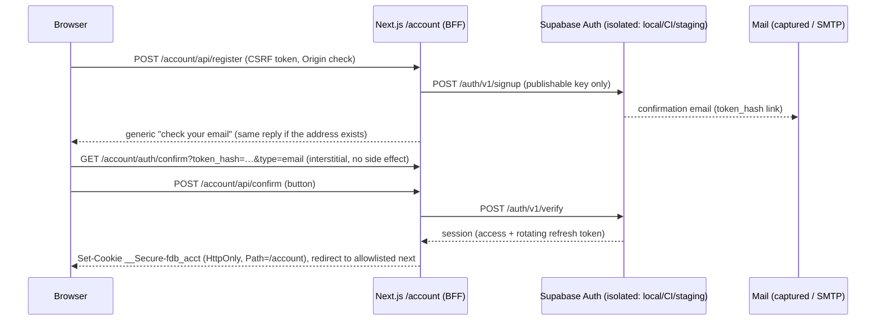

# Account System V1 — architecture

Status: **specification (PR A)**. Facts below were verified against `main` @ `2c31b4a` and, read-only, against the private production Supabase project on 2026-10-11. Nothing here was applied to production.

## 1. Audit of the actual current implementation

### Database (private Supabase `wow-forever`, read-only audit)

| Fact | Evidence |
| --- | --- |
| Migration ledger ends at `20261010151518 fix_observed_drop_rate_denominator` (`0011`). `0010` is **not** applied. No account objects exist. | `list_migrations` |
| 7 installations, **all owned by one anonymous Auth user**; 0 ownerless installations; 8 Auth users, all anonymous, 0 permanent users; 2 guilds / 47 members stored. | read-only `select` |
| `public.installations.owner_user_id uuid` (no FK, no NOT NULL) added by `0003`; ownership is set on first authenticated ingest and **never changes** (`coalesce(existing, new)`). | `0003`, `0005`, `0009` |
| Ingest takes `pg_advisory_xact_lock(hashtextextended(installation,0))`, then rejects a caller whose `auth.uid()` differs from a non-null owner: *"Installation belongs to another authenticated client"*. After an ownership transfer the previous owner therefore loses write access **without any change to ingest**. | `0003`, `0005`, `0009` |
| `0009`: every RPC calls `private.foreverdb_api_gate(scope)` which accepts any `authenticated` role (anonymous users are `authenticated`) and charges per-UID budgets (`ingest` 5 per 300 s per UID, reads 100 per 60 s, search 45, detail 65) plus global ceilings. | `0009` |
| Guildbook tables (`installation_guilds`, `_members`, `_professions`) are keyed by `installation_id`, RLS enabled with no policies, **all public/anon/authenticated table access revoked**; written only by the ingest `SECURITY DEFINER` function. **There is no remote Guildbook read RPC today**; the Companion renders its own local snapshot. | `0005`, advisor `rls_enabled_no_policy` (INFO, intentional) |
| Every existing public RPC is `SECURITY DEFINER` and executable by `authenticated` (intentional; the advisor lint is the accepted pattern). New account RPCs must additionally refuse anonymous callers. | advisor |
| Auth advisor: **leaked-password protection is disabled** (owner action, see checklist). | advisor |

### Companion (`companion/ForeverDB.Companion`, 0.8.2-alpha)

| Finding | Risk for accounts |
| --- | --- |
| `SupabaseAuthService.GetAccessTokenAsync()` returns a still-valid access token, else refreshes, and **on refresh failure clears the session and signs in anonymously**. | Unsafe for a registered session: it would silently replace the identity and orphan the account's installations. Anonymous fallback must be limited to an explicit anonymous mode. |
| `AuthSession` carries tokens and `UserId` only; there is **no session kind**. | The app cannot tell anonymous from registered. |
| `SessionStore` persists the whole session with DPAPI `CurrentUser` in `%LOCALAPPDATA%\ForeverDB\session.dat`, base64; `Load()` returns `null` on **any** exception; `Save()` is a non-atomic `File.WriteAllText`. | A torn write or corrupt file reads as "no session", which today triggers a new anonymous identity. For a registered user that is an identity downgrade. Needs atomic writes plus a plaintext, non-secret *kind marker* (classified by the JWT's `is_anonymous` claim when absent) so "unreadable registered session" becomes *re-auth required*, never anonymous. |
| In `GetAccessTokenAsync`, one bare `catch { SessionStore.Clear(); }` wraps **both** `RefreshAsync` and `SessionStore.Save`. | **A pre-existing defect that also hits anonymous users today:** being offline when the token expires (`HttpRequestException`), an antivirus lock on `Save` (`IOException`) or a parse error clears the session; the next start signs in as a *new* anonymous user, which fails the ingest owner check and orphans every installation. Only a definitive `invalid_grant` (HTTP 400/401) may clear anything. Fixed with regression tests in PR D (a fix to existing anonymous behaviour, in scope because the spec demands anonymous usage keep working). |
| Registering first would discard the anonymous session. | It is the only credential that can start a claim or sync the installations it owns; the design keeps it in a separate legacy slot (see the protocol). |
| A static `SemaphoreSlim` serialises session acquisition (concurrent startup is already handled). | Keep; extend to cover sign-in/out/claim transitions. |
| `SyncService` calls `GetAccessTokenAsync` then `ingest_foreverdb_snapshot_auth`. | Must pause while ownership is changing and understand "transferred" without creating a new identity. |
| `CompanionSettings` (`settings.json`) holds URL/key. | Must never hold credentials or tokens (V1 stores none there). |

### Website (`web/`, Next.js 16, Node 24)

| Finding | Consequence |
| --- | --- |
| `env.ts` rejects the private Supabase project reference and Supabase/service-role variable names on hosted deployments; fail-closed. | Kept intact. Accounts get a **separate, closed** configuration (§4). |
| `proxy.ts` issues the anonymous rate-limit cookie `__Host-fdb_sid`, nonce CSP, `X-ForeverDB-Deployment`, noindex outside production. | Account session cookie is a separate cookie (§5). CSP stays as is: the browser only talks to the same origin. |
| Public adapters (`lib/data`) use a PostgreSQL read model; no Auth. | Public browsing stays anonymous; static tests forbid account code reaching it. |
| GitHub ruleset on `main` is active; `release` controls Vercel Production (PR #46). | Account PRs target `main`; nothing is promoted to `release`. |

> **Implementation status (PR D):** the Companion findings above are resolved in Companion `0.9.0-alpha`; see [companion.md](companion.md) for the as-built design, the deviations (a third `pending-revoke.dat` slot, poll-based lock wait), and the test mapping.

## 2. Data flow

### Registration, verification, login (website)



### Ownership claim (Companion → website)

```mermaid
sequenceDiagram
  participant C as Companion (anonymous owner)
  participant P as Supabase PostgREST + DB (private)
  participant U as Registered user (browser)
  participant W as Website BFF
  C->>P: rpc fdb_account_claim_start(installation_id)  [owner JWT]
  P-->>C: code (shown once), expires in 10 min; only sha256 stored
  C-->>U: user copies the code
  U->>W: POST /account/api/link {code}  (verified session)
  W->>P: rpc fdb_account_claim_redeem(code)  [user's own JWT]
  P->>P: one transaction: advisory lock, lock claim + installation, recheck owner, transfer, link, audit, consume
  P-->>W: installation_id, linked_at
  Note over C,P: Anonymous owner's next ingest is rejected (not the owner any more).<br/>Companion shows "ownership transferred: sign in", never silently creates a new owner.
```

### Account Guildbook read

`Browser → /account/guildbook (server component, server-confirmed user) → /account/api/guildbook/* (CSRF-protected JSON) → lib/account/rpc-client.ts (closed PostgREST client, user JWT) → rpc fdb_account_guildbook_* → database re-derives ownership from auth.uid()`. Caller-supplied installation/guild identifiers are filters inside the caller's own set, never authorization.

## 3. Trust boundaries

| # | Boundary | Crosses | Controls |
| --- | --- | --- | --- |
| T1 | Internet → public website | anonymous visitors | existing: CSP, rate limits, Turnstile (optional), noindex outside production |
| T2 | Public website ↔ **account zone** | same process, different route prefix | single URL prefix `/account`, separate cookie with `Path=/account`, `private, no-store`, static import-boundary tests, no shared code with `lib/data` |
| T3 | Account zone → Supabase Auth/PostgREST (private project) | server-to-server HTTPS | closed endpoint and RPC allowlists (`contracts.ts`; `auth-client.ts` for Auth, `rpc-client.ts` for PostgREST: four web functions, fixed method/path/headers), publishable key only, user's own JWT, validated configuration (§4); PR E: [web-linking.md](web-linking.md) |
| T4 | Companion → Supabase | user's machine → internet | existing anon JWT / new registered JWT; DPAPI at rest; fail closed |
| T5 | Database role boundaries | `anon` / `authenticated` / definer | explicit REVOKE/GRANT per function, `search_path = ''`, in-function identity checks (registered + confirmed + active session) |
| T6 | Private Supabase ↔ **public PostgreSQL** (future) | none in V1 | physical separation; the website's public adapter has no route to the private project |

## 4. Auth-only configuration boundary (ADR-016)

The public site must not talk to the private project; accounts need exactly one narrow exception. Rather than loosening `env.ts`, a **second, closed validator** (`web/src/lib/account/config.ts`, wired into `evaluateEnv`) governs four variables: `ACCOUNT_AUTH_MODE`, `ACCOUNT_AUTH_URL`, `ACCOUNT_AUTH_PUBLISHABLE_KEY`, `ACCOUNT_AUTH_PROJECT_REF`. Facts enforced and tested:

- Disabled by default; stray values while disabled are an error (no half-configured state).
- `production` mode is unavailable: a code constant (`PRODUCTION_ACCOUNT_AUTH_APPROVED = false`) must be flipped by a reviewed change after owner approval; no environment variable can do it.
- `local`: developer machine only, loopback origin. `staging`: https `<ref>.supabase.co`, **not** the private production project, project ref confirmed twice, never on ForeverDB production, never on Vercel's production target (the demonstration alias), so account code cannot reach the production alias even by misconfiguration.
- Keys: `sb_publishable_…` or an anon JWT (role `anon`, project ref consistent). Secret keys and service-role JWTs are refused; unknown `ACCOUNT_AUTH_*` names are refused.
- The global guard still rejects the private project reference everywhere else and still rejects `SUPABASE*`/service-role variable names on hosted deployments. Tests assert that explicitly.
- The public data adapter, rate limiter and API helpers cannot import account code or read `ACCOUNT_AUTH_*` (static tests).

### Option analysis

| Option | Verdict | Why |
| --- | --- | --- |
| A. Browser talks to Supabase Auth (`supabase-js` in the browser) | Rejected | Refresh tokens live in JavaScript-readable storage; the project URL and key must ship in bundles (the bundle scan deliberately forbids the private project reference); CSP `connect-src` would have to widen; XSS becomes account takeover. |
| **B. Server-side BFF in an isolated `/account` route group (chosen)** | **Selected** | Tokens only in HttpOnly cookies scoped to `/account`; browser JavaScript never sees a token; CSP unchanged; CSRF and redirect rules enforced server-side; Auth origin and key never reach a bundle; one deployment. Cost: the account zone shares a process with the public site, mitigated by the static boundary, separate cookie path, no shared modules and `private, no-store`. |
| C. Separate account origin/app | Deferred | Strongest isolation (cookie scope, CSP, env, blast radius) but a second deployment, domain and release pipeline before a custom domain exists. The URL prefix and contracts are designed so zone B can move to its own origin later without protocol changes. |

## 5. Web session design

**Routes.** Everything account-related lives under one URL prefix: pages at `/account/*`, the backend-for-frontend at **`/account/api/*`** (route handlers in `src/app/account/api/`). There is no `/api/account`: a path-scoped cookie is not sent to a different prefix (a static test fails if `src/app/api/account` ever exists).

- **Libraries.** Evaluate `@supabase/ssr` (PKCE-aware cookie client for Next.js) and `@supabase/supabase-js` in PR B against the exact installed versions. All Auth traffic goes through one wrapper that checks `isAllowedAuthRequest(method, pathAndQuery, {callbackUrl})` and validates the body against `AUTH_BODIES` before sending. The allowlist pins query parameters: **logout is always `scope=local`** (Auth's default is global, which would also sign the Companion out and break session independence), `redirect_to` is accepted only when equal to the one server-computed callback URL, duplicate and unknown parameters are refused. Bodies are strict: sign-up carries only `email` and `password` (no `data`/user_metadata, and a body-less sign-up, which in GoTrue creates an *anonymous* user, is impossible from the website); `PUT /user` accepts only `password`, there is no email change in V1, and it is used only inside a recovery session.
- **Cookie.** `__Secure-fdb_acct` on https (`fdb_acct` on local http), `HttpOnly; Secure; SameSite=Lax; Path=/account`, chunked if needed. Because the path is `/account`, **public pages and APIs never receive it**, and neither do CDN cache keys for them. It is unrelated to the anonymous rate-limit cookie `__Host-fdb_sid`. The `__Host-` prefix would force `Path=/` and is therefore not used; the `__Secure-` prefix still guarantees Secure.
- **No trust in cookie contents.** Authorization on private pages and APIs uses the **server-confirmed user** (`getUser()`: Auth validates the JWT *and* that the session still exists), so logout and revocation take effect immediately. `getClaims()` (signature-verified, no round trip) is used only for low-risk rendering such as the header's "signed in" state. `getSession()` data is never used for authorization.
- **Defence in depth in the database.** Every account RPC re-checks identity inside the database: role `authenticated`, user not banned/deleted, and the JWT's `session_id` still present in a live `auth.sessions` row **for every caller, including the anonymous owner starting a claim**; registered-only functions additionally require `is_anonymous = false` and a confirmed email. A captured access token (anonymous or registered) is therefore useless once its session is revoked.
- **CSRF.** All state changes are `POST` (JSON or form) with: exact `Origin` equality with `SITE_URL`, `Sec-Fetch-Site: same-origin` when sent (a request with neither header is refused), and a **signed** double-submit token: random nonce + HMAC-SHA256 under `ACCOUNT_CSRF_SECRET`, bound to the session cookie (or, before login, to a short-lived pre-session nonce), carried in a `SameSite=Strict`, `HttpOnly`, `Path=/account` cookie and in a hidden field/header. Signing is required because a path-scoped cookie cannot use the `__Host-` prefix, so a plain double-submit value could be planted by a sibling subdomain once a custom domain exists. Login and registration are covered too (login-CSRF).
- **Redirects.** `safeNext()` allowlist of exact pathnames, drops query and fragment, handles encodings at any depth; Auth-side Site URL / redirect allowlists are owner settings restricted to the exact callback URL.
- **Confirmation and recovery callbacks.** Email links carry `token_hash` and land on a **GET interstitial with no side effect**; a POST button performs `verify`, so mail scanners that prefetch links cannot consume the one-time token. Account HTML responses send `Referrer-Policy: strict-origin`: Referer can contain only the site origin, never an Account path, query or `token_hash`, while a same-origin native form POST keeps its concrete Origin for the fail-closed CSRF check. Account API/file responses remain `no-referrer`. The page removes `token_hash` from the address bar (`history.replaceState`) immediately, and the query string is excluded from application logs.
- **Refresh and rotation.** Refresh happens only where cookies can be set (route handlers and the `/account` proxy path) and a proxy refresh must also forward the **rotated** cookie to the downstream request. Per-process single-flight does not help on serverless, so the design does not rely on it: the Auth project keeps refresh-token rotation on with the default reuse interval (the documented window that tolerates concurrent refreshes), and a detected reuse is handled fail-safe (the session is revoked and the user signs in again). Auth settings that couple sessions across clients (**single session per user**, session time-boxing, inactivity timeout) must stay **off**, otherwise a website login would sign the Companion out.
- **Enumeration.** Sign-up, login and recovery respond identically whether or not the address exists; per-IP and per-email (HMAC-hashed with the existing salt) throttles through the existing limiter; generic messages only.
- **Edge handling in the existing proxy (PR B).** `proxy.ts` currently treats only `/api/` paths as API (so `/account/api/*` must be added to `isApi`) and the existing limiter rules cover only GET/HEAD (so POST `/account/api/*` needs its own per-IP rule, plus the per-email limiter). `/account/**` is excluded from the anonymous-cookie issuance.
- **Caching and logging.** Every `/account` page and API sends `Cache-Control: private, no-store` and `X-Robots-Tag: noindex, nofollow` in every deployment, is never in the sitemap, never statically generated, and logs no email addresses, tokens, claim codes or user IDs.
- **CAPTCHA.** Supabase's CAPTCHA protection is project-wide: it also applies to anonymous sign-in and password sign-in, which the Companion cannot satisfy (`SupabaseAuthService` sends no token). It therefore must **not** be enabled on a project the Companion uses. The website protects its own sign-up and recovery routes with a server-side Turnstile verification (existing challenge infrastructure) *before* calling Auth (layer 1). That does **not** protect Auth itself: the Companion exposes the URL and publishable key, so anyone can call GoTrue directly for anonymous sign-up, password sign-in and mail (threat A24, **open**). Auth's own project limits (layer 2), direct anonymous-signup and password-auth abuse (layers 3 and 4), mail quotas (layer 5) and monitoring with incident response (layer 6) are distinct owner-managed controls with enforceable criteria: [security.md §3.1](security.md) and [acceptance §5](acceptance-and-owner-actions.md); the staging acceptance runs the Companion's anonymous sign-in and refresh against the exact Auth settings in force.
- **Existing controls retained.** CSP with nonce, request limits, security headers, noindex preview policy.

## 6. Environments and separation

| Environment | Auth | Mail | Purpose | Status |
| --- | --- | --- | --- | --- |
| Local developer | Supabase CLI local stack (loopback) | Mailpit/Inbucket capture | development | usable now (CLI + Docker on the developer's machine) |
| CI (ephemeral) | `supabase start` in GitHub Actions | captured | PRs B, C, E automated acceptance with **real GoTrue and Postgres** | planned in PR B |
| **Staging** | separate Supabase project owned by the owner | real SMTP (owner) | true end-to-end acceptance incl. email delivery, Windows Companion | **owner action required** |
| Production (`wow-forever`) | existing private project | — | — | **BLOCKED** (code constant, owner approval, dry-run, rollback) |

An unrestricted development Preview never points at the production Auth database: the validator forbids it. Creating a staging project, SMTP, CAPTCHA and any Auth setting is an owner decision (see [acceptance-and-owner-actions.md](acceptance-and-owner-actions.md)).

This authoring environment cannot start Docker, run .NET, or reach `*.vercel.app`/Docker Hub; real-Auth and Windows evidence must therefore come from GitHub Actions, the owner's staging project and the owner's Windows machine. Those tiers are reported as exactly that, never as passed by local simulation.

## 7. Audit appendix (read-only, executed 2026-10-11 through the Supabase connector against `klxhikdlfwgxurdyexdi`)

No data was modified. The statements in section 1 come from these queries; the owner can re-run them in the SQL editor.

```sql
-- migration ledger
select version, name from supabase_migrations.schema_migrations order by version;   -- via list_migrations
-- ownership and identity facts
select
  (select count(*) from public.installations)                                             as installations,        -- 7
  (select count(*) from public.installations where owner_user_id is null)                 as ownerless,            -- 0
  (select count(distinct owner_user_id) from public.installations)                        as distinct_owners,      -- 1
  (select count(*) from auth.users)                                                       as auth_users,           -- 8
  (select count(*) from auth.users where is_anonymous)                                    as anonymous_users,      -- 8
  (select count(*) from auth.users where not is_anonymous)                                as permanent_users,      -- 0
  (select count(*) from public.installations i join auth.users u on u.id = i.owner_user_id where u.is_anonymous) as installs_owned_by_anon, -- 7
  (select count(*) from public.installation_guilds)                                       as guilds,               -- 2
  (select count(*) from public.installation_guild_members)                                as guild_members,        -- 47
  (select max(c) from (select count(*) c from public.installations group by owner_user_id) t) as max_installs_per_owner; -- 7
```

Security advisor (`get_advisors`, type `security`): `rls_enabled_no_policy` INFO on the seven private tables (intentional), `authenticated_security_definer_function_executable` WARN on the nine gated RPCs (the accepted design), `auth_leaked_password_protection` WARN (owner action). The ledger ends at `20261010151518 fix_observed_drop_rate_denominator`; `0010` is not applied.
