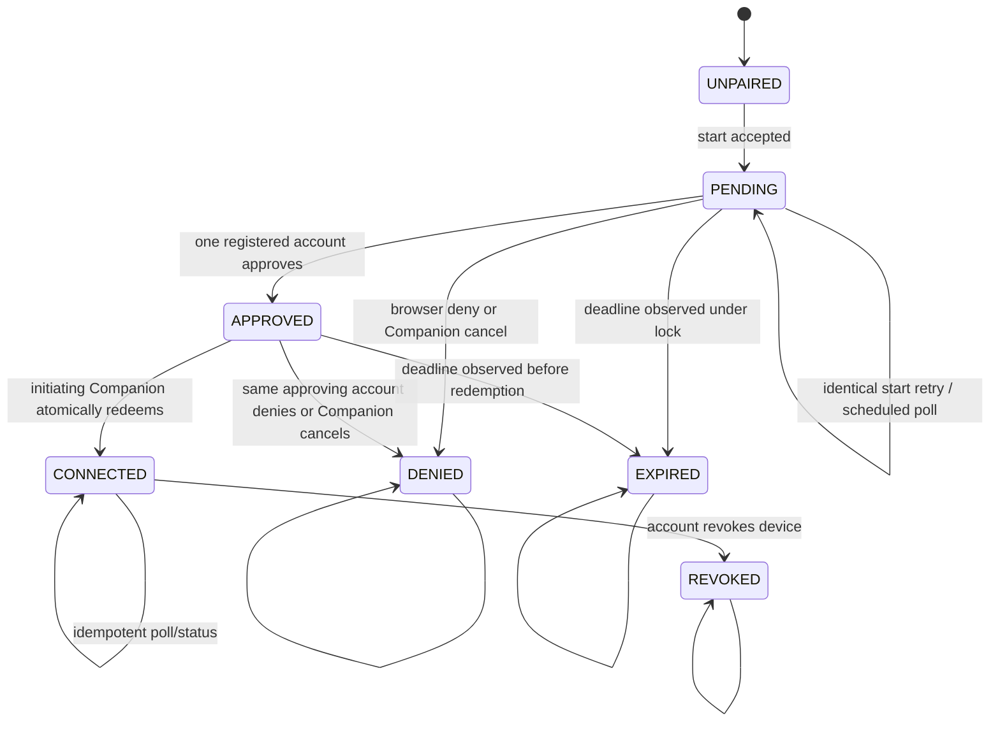

# Browser Pairing V1 — database model and state machine

## Tables and provenance

Migration `0016_browser_pairing.sql` adds:

### `private.device_pairing_config`

Singleton row with `enabled boolean not null default false`, `updated_at` and no API-role privileges. Every pairing RPC reads it and
returns `feature_disabled` before disclosing request state when false.

### `private.device_pairings`

Required columns:

| Column | Purpose |
| --- | --- |
| `id uuid primary key` | Companion-generated public locator and start idempotency key |
| `installation_id text` | Existing installation identity; never rewritten |
| `initiator_uid uuid` | Anonymous `auth.uid()` captured at start |
| `initiator_session_id uuid` | Exact GoTrue `session_id` captured at start |
| `poll_secret_hash bytea` | 32-byte SHA-256 verifier; unique |
| `proposed_device_id uuid` | Companion-generated device ID; unique |
| `device_credential_hash bytea` | 32-byte SHA-256 verifier of the DPAPI-held device credential |
| `computer_label text` | Sanitized display label, nullable, maximum 60 |
| `status text` | `pending`, `approved`, `connected`, `expired`, `denied`, `revoked` |
| `created_at`, `expires_at` | Maximum lifetime five minutes |
| `next_poll_at`, `poll_interval_sec` | authoritative polling schedule, 5–30 seconds |
| `approved_account_uid`, `approved_at` | chosen only from a registered caller, null before approval |
| `connected_device_id`, `connected_at` | set only in the redemption transaction |
| `denied_at`, `denied_reason` | internal fixed reason; not exposed verbatim |
| `revoked_at` | copied when the paired device is later revoked |

Checks enforce state-dependent nullability. Partial unique indexes permit at most one `pending` or `approved` row per installation and
per initiating UID. `connected_device_id` and `proposed_device_id` are unique. Tables have FORCE RLS, no policies and no grants to
`public`, `anon`, `authenticated` or `service_role`; SECURITY DEFINER functions have empty search paths and fixed timeouts.

`private.devices.ticket_id` becomes nullable and gains `pairing_id uuid references private.device_pairings(id)`. A check requires
exactly one of `ticket_id` or `pairing_id`. Existing ticket rows satisfy it unchanged. A unique non-null pairing index prevents two
devices from one request.

For an existing anonymous installation transfer, `private.account_installations.claim_id` becomes nullable and gains `pairing_id`.
Exactly one provenance column must be present. New placeholder installations need no transfer-history row because they had no previous
owner. Existing claim rows remain unchanged.

The existing audit tables gain only fixed pairing events and identifiers; no locator, secret, verifier, Auth session ID, email or raw
machine name is written to audit.

## State machine

`UNPAIRED` is not stored. It means no usable active device and no locally pending pairing.

## Transition authorization

| Transition | Actor and proof |
| --- | --- |
| create pending | exact active anonymous UID/session; installation absent or owned by that UID, or controlled same-account re-enrollment |
| pending to approved | live confirmed registered session, browser CSRF/Origin checks, locator cookie, compatible current owner |
| pending to denied | any live registered browser holder before approval, or exact initiating session + poll secret |
| approved to denied | same approved account, or exact initiating session + poll secret |
| approved to connected | exact initiating UID/session + poll secret; account remains usable |
| pending/approved to expired | any operation observing `expires_at <= clock_timestamp()` under the row lock |
| connected to revoked | existing account device-revoke RPC by the owning account |

## Global lock order

Every function follows this order and never acquires an earlier class after a later class:

1. perform an unlocked, non-authoritative pairing lookup only to learn the installation ID;
2. `pg_advisory_xact_lock(hashtextextended(installation_id, 0))`;
3. lock and revalidate the caller's `auth.sessions` row (`FOR SHARE`);
4. lock the pairing row `FOR UPDATE` and re-check every value and deadline;
5. for redemption, take `fdb-account:<approved_uid>` advisory lock;
6. take `fdb-device-identity:<initiator_uid>` advisory lock;
7. lock the installation row and relevant live/revoked device rows;
8. insert/update link, device, pairing and audit rows.

Start has no pairing row to lock. It takes the installation lock, revalidates the caller session, takes a pairing-ID advisory lock, then
inserts or validates an identical row. Approve/deny do not take account or device locks because they have no ownership/device side
effect. Device revocation already starts with the installation lock and will update the pairing state in the same transaction.

## Redemption invariants

The `approved -> connected` transaction must establish all of the following before commit:

1. The pairing row is approved, unexpired and holds the submitted poll-secret hash.
2. JWT UID and session ID equal the stored initiator values; that exact anonymous session is live.
3. The approved account is confirmed, active, not banned/deleted and within ownership/device limits.
4. If the installation exists with an anonymous owner, that owner equals the initiator. If it has a registered owner, it equals the
   approved account and the request satisfies controlled re-enrollment. Any other owner fails closed.
5. No active device exists for another Auth UID, installation or account. A revoked predecessor may be retained as history.
6. For an existing anonymous installation, the Account V1 link row and `owner_user_id` update use pairing provenance and the original
   owner UID. For a missing installation, the same schema-version-zero placeholder used by 0014 is inserted for the approved account.
7. The device row uses the proposed ID, initiating Auth UID, approved account, installation, committed credential hash and pairing
   provenance.
8. `connected_device_id`, `connected_at` and status `connected` are written last in the transaction; audit records the nonsecret IDs.

Any exception rolls back all eight effects. A later poll of a committed row returns the stored device ID without updating ownership,
creating a device or duplicating the success audit event.

## Required concurrency proofs

- two accounts approve concurrently: one `approved`, one `already_decided`, one recorded UID;
- approve races deny: exactly one permitted transition wins;
- approve races expiry: the locked clock check allows approval or expiry, never both;
- two valid polls race after approval: one redemption transaction, one device, one link, one ownership change, one success audit;
- valid poll races Companion cancel: connected or denied, with no partial device/link;
- valid poll races account device revocation/re-enrollment: shared installation/device locks preserve one live device;
- poll with a wrong session of the same UID races a valid poll: wrong session has no effect;
- retry after a committed but lost poll response: connected response, zero additional writes;
- start retries concurrently with identical values: one row and identical outcome; changed verifier: conflict;
- pairing redemption racing existing ingest/claim/ticket enrollment cannot deadlock and cannot change another owner's installation.
