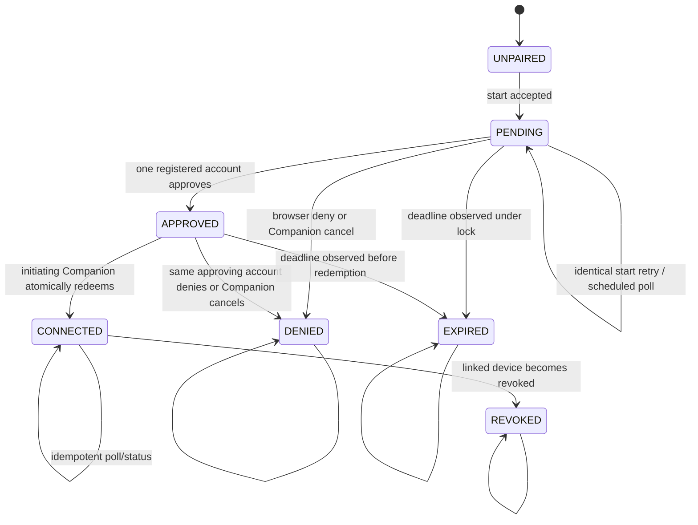

# Browser Pairing V1 — database model and state machine

## Tables and provenance

Migration `0016_browser_pairing.sql` adds:

### `private.device_pairing_config`

Singleton row with `enabled boolean not null default false`, `updated_at` and no API-role privileges. Every pairing RPC reads it and
returns `feature_disabled` before disclosing request state when false.

### `private.device_pairings`

Required columns:

| Column | Purpose |
| --- | --- |
| `id uuid primary key` | Companion-generated public locator and start idempotency key |
| `audit_ref uuid unique not null` | server-generated nonpublic identifier used by the pairing audit table |
| `installation_id text` | Existing installation identity; never rewritten |
| `initiator_uid uuid` | Anonymous `auth.uid()` captured at start |
| `initiator_session_id uuid` | Exact GoTrue `session_id` captured at start |
| `poll_secret_hash bytea` | 32-byte SHA-256 verifier; unique |
| `proposed_device_id uuid` | Companion-generated device ID; unique |
| `device_credential_hash bytea` | 32-byte SHA-256 verifier of the DPAPI-held device credential |
| `computer_label text` | Sanitized display label, nullable, maximum 60 |
| `status text` | `pending`, `approved`, `connected`, `expired`, `denied`, `revoked` |
| `created_at`, `expires_at` | Maximum lifetime five minutes |
| `next_poll_at`, `poll_interval_sec` | authoritative polling schedule, 5–30 seconds |
| `approved_account_uid`, `approved_session_id`, `approved_at` | chosen only from the exact registered caller/session, null before approval |
| `previous_owner_uid` | anonymous owner captured only when redemption transfers ownership |
| `connected_device_id`, `connected_at` | set only in the redemption transaction |
| `denied_at`, `denied_reason` | internal fixed reason; not exposed verbatim |
| `revoked_at` | copied when the paired device is later revoked |

Checks enforce state-dependent nullability. Partial unique indexes permit at most one `pending` or `approved` row per installation and
per initiating UID. `connected_device_id` and `proposed_device_id` are unique. Tables have FORCE RLS, no policies and no grants to
`public`, `anon`, `authenticated` or `service_role`; SECURITY DEFINER functions have empty search paths and fixed timeouts.

`device_credential_hash` is a verifier scoped to the proposed device, not a global device identity. Duplicate hashes do not authorize
another device because credential parsing routes authorization by the embedded device UUID and then compares that row's hash. A
malicious nonofficial client which commits a hash whose embedded UUID differs from `proposed_device_id` creates an unusable binding;
the official Companion prevents that mismatch before start. Server-enforced collision handling applies to the unique device ID.

`private.devices.ticket_id` becomes nullable and gains `pairing_id uuid references private.device_pairings(id)`. A check requires
exactly one of `ticket_id` or `pairing_id`. Existing ticket rows satisfy it unchanged. A unique non-null pairing index prevents two
devices from one request.

`private.account_installations` and its claim-only constraints remain unchanged. For an existing anonymous installation transfer, the
pairing row stores `previous_owner_uid` in the same transaction as the authoritative `owner_user_id` change. New placeholder
installations have no previous owner.

Migration 0016 adds an `AFTER UPDATE OF status` trigger on `private.devices`. Whenever a pairing-provenance device changes to
`revoked`, the trigger changes the connected pairing to `revoked` and copies `revoked_at` in the same transaction. This covers owner
revocation, retired-credential reuse, same-identity replacement and future revocation paths without modifying each caller separately.

### `private.device_pairing_audit`

Migration 0016 leaves `private.account_audit` and its migration 0012 event constraint unchanged. It creates a closed pairing-only audit
table with `id bigint identity`, `at timestamptz`, `event`, `pairing_audit_ref`, `installation_id`, nullable `account_uid`, nullable
`device_id` and nullable fixed `reason`. `pairing_audit_ref` references the server-generated nonpublic value on the pairing row; no
public locator, secret, verifier, Auth session ID, email or raw machine name is copied into audit.

The event check permits exactly `pairing_started`, `pairing_approved`, `pairing_denied`, `pairing_expired`, `pairing_connected`,
`pairing_revoked` and `pairing_retry_deferred`. State-transition events are inserted in the same transaction as their transition, with
a partial unique `(pairing_audit_ref, event)` index excluding `pairing_retry_deferred`. Deferred events are written at most once per
fixed reason through a partial unique `(pairing_audit_ref, event, reason)` index and are used only for `account_limit` or
`device_limit`. Invalid actor/secret/locator, early
poll, rate limit, feature gate and infrastructure errors never write pairing audit. `pairing_connected` is the single success audit;
`pairing_denied` and `pairing_revoked` carry only an allow-listed internal reason.

## State machine

`UNPAIRED` is not stored. It means no usable active device and no locally pending pairing.

## Transition authorization

| Transition | Actor and proof |
| --- | --- |
| create pending | exact active anonymous UID/session; installation absent or owned by that UID, or controlled same-account re-enrollment |
| pending to approved | exact live confirmed registered UID/session, browser CSRF/Origin checks, locator cookie, compatible current owner |
| pending to denied | any live registered browser holder before approval, or exact initiating session + poll secret |
| approved to denied | same approved account, or exact initiating session + poll secret |
| approved to connected | exact initiating UID/session + poll secret; exact approving session and account remain usable |
| pending/approved to expired | any operation observing `expires_at <= clock_timestamp()` under the row lock |
| connected to revoked | device trigger observes any valid device transition to revoked |

## Global lock order

Every function follows this order and never acquires an earlier class after a later class:

1. validate input and the feature gate without a pairing-specific write;
2. charge the per-principal abuse budget;
3. perform an unlocked, non-authoritative pairing lookup only to learn the installation ID;
4. `pg_advisory_xact_lock(hashtextextended(installation_id, 0))`;
5. charge the global abuse budget;
6. lock and revalidate the caller's `auth.sessions` row (`FOR SHARE`);
7. lock the pairing row `FOR UPDATE` and re-check actor, secret, every immutable binding, state and deadline;
8. only after that proof succeeds, charge a pairing-specific budget and mutate `next_poll_at` or `poll_interval_sec`;
9. for redemption, lock and revalidate the approving `auth.sessions` row, then take `fdb-account:<approved_uid>` advisory lock;
10. take `fdb-device-identity:<initiator_uid>` advisory lock;
11. lock the installation row and relevant live/revoked device rows;
12. insert/update owner, device, pairing and audit rows.

An invalid locator, secret or actor may charge only the principal/global abuse budgets. It must not mutate the pairing row,
pairing-specific budget, `next_poll_at` or interval. Start has no pairing row to lock; it follows the same class ordering using its
installation and pairing-ID advisory locks before inserting or validating an identical row. Approve/deny stop after the pairing/session
classes because they have no ownership/device side effect. Device revocation begins with the installation lock and the trigger updates
the pairing state in the same transaction.

## Controlled re-enrollment predicate

An account-owned installation may start and redeem a new pairing only when all conditions hold under the installation/device locks:

1. no non-revoked device exists for the installation;
2. the latest predecessor device has the same installation ID, current owner account UID and initiating anonymous Auth UID;
3. that predecessor is revoked with fixed reason `owner_revoked`, `credential_reuse` or `replaced`;
4. approval uses the current owner account, so another account cannot acquire or rebind it.

An owner must revoke an active device through the website before re-enrollment. Redemption rechecks the predicate and inserts a new
active device with a fresh ID and credential. It never reactivates or overwrites the revoked predecessor.

## Redemption invariants

The `approved -> connected` transaction must establish all of the following before commit:

1. The pairing row is approved, unexpired and holds the submitted poll-secret hash.
2. JWT UID and session ID equal the stored initiator values; that exact anonymous session is live.
3. The exact approving browser session is live; the approved account is confirmed, active and not banned/deleted.
4. If the installation exists with an anonymous owner, that owner equals the initiator. If it has a registered owner, it equals the
   approved account and the request satisfies controlled re-enrollment. Any other owner fails closed.
5. No active device exists. For re-enrollment, the locked predecessor satisfies the complete controlled predicate above.
6. For an existing anonymous installation, the pairing row captures `previous_owner_uid` and the `owner_user_id` update occurs in the
   same transaction. For a missing installation, the same schema-version-zero placeholder used by 0014 is inserted for the approved
   account.
7. The device row uses the proposed ID, initiating Auth UID, approved account, installation, committed credential hash and pairing
   provenance.
8. `connected_device_id`, `connected_at` and status `connected` are written last in the transaction; audit records the nonsecret IDs.

Any exception rolls back all eight effects. A later poll of a committed row returns the stored device ID without updating ownership,
creating a device or duplicating the success audit event.

Before ownership/device writes, failure classification is deterministic. Revoked approving session, unavailable account, ownership
conflict, failed re-enrollment predicate, and proposed device ID collisions change `approved` to terminal `denied` with a fixed
internal reason. Account/device limits remain `approved` and retryable until expiry so the owner can revoke a device; lock timeout,
rate limit and temporary server failure are also retryable and make no pairing-state write. A disabled feature gate never mutates state.

## Required concurrency proofs

- two accounts approve concurrently: one `approved`, one `already_decided`, one recorded UID;
- approve races deny: exactly one permitted transition wins;
- approve races expiry: the locked clock check allows approval or expiry, never both;
- two valid polls race after approval: one redemption transaction, one device, one ownership change/provenance write, one success audit;
- valid poll races Companion cancel: connected or denied, with no partial device/ownership write;
- valid poll races account device revocation/re-enrollment: shared installation/device locks preserve one live device;
- approving browser session is revoked while poll waits: terminal denied, no ownership/device write;
- active predecessor, wrong Auth UID/account/installation, disallowed reason and non-latest predecessor each reject re-enrollment;
- every existing device-revocation cause propagates connected to revoked through the trigger;
- poll with a wrong session of the same UID races a valid poll: wrong session has no effect;
- wrong locator, secret or actor leaves pairing budget, interval and `next_poll_at` byte-for-byte unchanged;
- retry after a committed but lost poll response: connected response, zero additional writes;
- start retries concurrently with identical values: one row and identical outcome; changed verifier: conflict;
- concurrent and repeated transitions emit one audit row for each state event and at most one deferred row for each allowed limit reason;
- pairing redemption racing existing ingest/claim/ticket enrollment cannot deadlock and cannot change another owner's installation.
