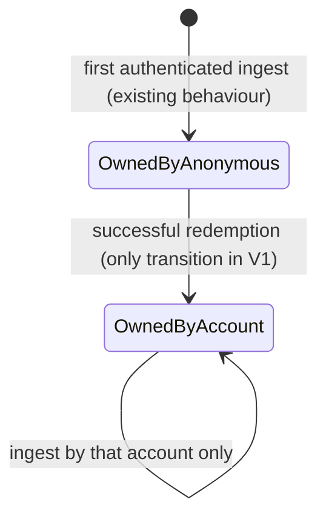

# Account System V1 — installation ownership claim protocol

Status: **specification (PR A)**; implemented in PR C (migration `0012`) and PR D (Companion). Nothing here is applied to any real database.

Goal: move `public.installations.owner_user_id` from the installation's current owner (typically an **anonymous** Supabase Auth UID) to a **verified registered** account, atomically, without touching a single observation, location, item, source or Guildbook row, and without any way to take over an installation by knowing its ID.

## 1. Design rules

1. **An installation ID is an identifier, never proof.** Redemption takes the *code only*; the installation is looked up from the claim.
2. **Only the current owner can issue a claim**, from its own JWT, and only an **anonymous** owner (a registered owner moving to a different account is a cross-account transfer and is out of V1).
3. **Only a registered, email-confirmed, active-session user can redeem.**
4. **128-bit code, 10-minute life, single use, hash only at rest** (SHA-256 of the 32-hex-character code; with 128 bits of entropy a plain digest is sufficient, no salt or pepper needed).
5. **One live code per installation:** issuing a new code revokes the previous pending one.
6. **Business failures are results, not exceptions.** A PostgreSQL exception rolls back the rate-limit counter written in the same transaction. Failures (wrong code, expired, replay, wrong owner) therefore return `{ok:false}` so the throttle and attempt counters persist. Exceptions are reserved for authentication/authorization (`PT401`/`PT403`) and budget exhaustion (`PT429`).
7. **One indistinguishable failure** (`invalid_claim` / `not_available`) for not-found, expired, consumed, revoked, owner-mismatch and unknown-installation, so there is no existence or state oracle.
8. **No plaintext codes, tokens or IPs** in tables, audit rows, logs or error messages.

## 2. State machines

### Claim

```mermaid
stateDiagram-v2
  [*] --> pending: claim_start (owner JWT, anonymous)
  pending --> consumed: claim_redeem (registered, rechecks owner)
  pending --> revoked: newer claim_start for the same installation
  pending --> revoked: 5 failed redeem attempts against this claim
  pending --> expired: now() > expires_at (lazy; never redeemable)
  consumed --> [*]
  revoked --> [*]
  expired --> [*]
```



Expiry is evaluated at redemption time (`expires_at > now()`); a periodic prune deletes terminal claims older than 7 days and audit rows older than 180 days.

### Installation ownership



There is deliberately no automatic transition back. Recovery is a documented, owner-approved, audited operator procedure (§7).

### Companion session

| State | Meaning | Tokens | Remote sync | Remote account features |
| --- | --- | --- | --- | --- |
| `LoggedOut` | first run, or explicit sign-out of a registered account | none | off | off |
| `Anonymous` | explicit anonymous mode (today's behaviour) | anonymous JWT | on (owned installations) | off |
| `AnonymousClaiming` | anonymous with a pending claim shown | anonymous JWT | on until transfer | off |
| `Registered` | email/password session, installation owned by this account | registered JWT | on | on |
| `ReauthRequired` | registered session unusable: refresh rejected, session file unreadable (marker says registered), or ownership transferred and no registered session yet | none usable | **off** | off |

Transitions (all serialised by the single session gate):

| From | Event | To | Notes |
| --- | --- | --- | --- |
| `LoggedOut` | user chooses "Use without an account" | `Anonymous` | the only way an anonymous identity is ever created |
| `LoggedOut` / `Anonymous` | registered sign-in succeeds | `Registered` | anonymous tokens are discarded locally only after the registered session is stored |
| `Anonymous` | start claim | `AnonymousClaiming` | code shown once |
| `AnonymousClaiming` | status poll returns `transferred` | `ReauthRequired` | message: "ownership moved to your account, sign in" |
| `Registered` | refresh succeeds | `Registered` | rotated refresh token persisted atomically |
| `Registered` | refresh rejected / network ok | `ReauthRequired` | **never** `Anonymous`; never creates an identity |
| `Registered` | refresh fails for network reasons | `Registered` (retry) | transient; sync pauses, session kept |
| `Registered` | explicit sign-out | `LoggedOut` | server-side revoke; local file removed; **not** `Anonymous` |
| any | session file unreadable and kind marker = registered | `ReauthRequired` | corruption never downgrades identity |
| any | session file unreadable and marker absent/anonymous | `Anonymous` only if the user previously chose anonymous mode, else `LoggedOut` | |
| `Registered` | status for the installation is not `owned` | stay `Registered`, installation sync disabled | different account signed in: explain, do not ingest |

Anonymous local collection (reading SavedVariables, local search and Guildbook view) keeps working in every state; only remote sync and account features are gated.

## 3. Schema (migration `0012_account_ownership_claims.sql`, private schema)

```sql
-- all objects in schema private; RLS enabled with no policies; ALL privileges revoked from public, anon, authenticated, service_role
create table private.installation_claims (
  id              uuid primary key default gen_random_uuid(),
  installation_id text not null references public.installations(id) on delete cascade,
  initiator_uid   uuid not null,                 -- the owner at issue time
  code_hash       bytea not null unique,         -- sha256(code); plaintext never stored
  status          text not null check (status in ('pending','consumed','revoked')),
  attempts        integer not null default 0,
  created_at      timestamptz not null default now(),
  expires_at      timestamptz not null,
  consumed_at     timestamptz,
  consumed_by     uuid
);
create unique index installation_claims_one_pending
  on private.installation_claims (installation_id) where status = 'pending';

create table private.account_installations (     -- the verified, active link; PK = one active owner
  installation_id    text primary key references public.installations(id) on delete restrict,
  account_uid        uuid not null,
  linked_at          timestamptz not null default now(),
  claim_id           uuid not null references private.installation_claims(id),
  previous_owner_uid uuid not null                -- enables an audited manual restore
);
create index account_installations_account_idx on private.account_installations (account_uid);

create table private.account_audit (               -- minimal: no code, email, IP or token
  id              bigint generated always as identity primary key,
  at              timestamptz not null default now(),
  event           text not null check (event in ('claim_started','claim_redeemed','claim_revoked','redeem_rejected')),
  account_uid     uuid,
  installation_id text,
  claim_id        uuid
);
```

`public.installations` and every child table are **not altered**. `on delete restrict` on the link prevents an installation delete from silently erasing the link record.

## 4. Function contracts (all `SECURITY DEFINER`, `set search_path = ''`, every object schema-qualified; `revoke all ... from public, anon, authenticated, service_role; grant execute ... to authenticated`)

Shared guards (in `private`, not callable by clients):

- `fdb_caller()` — role `authenticated`, `auth.uid()` not null (anonymous allowed).
- `fdb_registered_caller()` — everything in `fdb_caller()` **plus**: `auth.users.is_anonymous = false`, `email_confirmed_at is not null`, `deleted_at is null`, `banned_until` null or past, and the JWT's `session_id` exists in `auth.sessions` for this user and has not expired. A captured access token is therefore useless as soon as its session is revoked. (Checked against real GoTrue in the CI and staging suites; `auth.sessions` semantics are the one Supabase-version dependency, so the migration's pre-flight asserts the table and columns exist.)

| Function | Caller | Behaviour |
| --- | --- | --- |
| `fdb_account_claim_start(p_installation_id text) → jsonb` | current owner, **anonymous** | validate id shape; budgets: `claim_start:uid:<uid>` 3 per 300 s, `claim_start:inst:<id>` 3 per 300 s, global 60 per 300 s; `pg_advisory_xact_lock(hashtextextended(id,0))` (**same key as ingest**); `select … from public.installations where id = $1 for update`; owner must equal `auth.uid()` and the caller must be anonymous; revoke previous pending claim (audit `claim_revoked`); generate `upper(encode(extensions.gen_random_bytes(16),'hex'))`, store `extensions.digest(code,'sha256')`, `expires_at = now()+10 min`; audit `claim_started`; return `{ok:true, code, expires_at}`. Any precondition failure returns `{ok:false,error:'not_available'}`. |
| `fdb_account_claim_redeem(p_code text) → jsonb` | **registered** | `fdb_registered_caller()`; budgets `claim_redeem:uid:<uid>` 10 per 300 s, global 300 per 300 s; format check `^[0-9A-F]{32}$`; hash; look up the claim by hash (no lock) → none ⇒ audit `redeem_rejected`, `{ok:false,error:'invalid_claim'}`; take the **advisory lock for the claim's installation**; re-select the claim `for update` and the installation `for update`; require `status='pending' and expires_at > now()`, installation exists, `owner_user_id = claim.initiator_uid`, `auth.uid() <> initiator_uid`, account's active links < 50, else increment `attempts` (revoke at 5), audit, `{ok:false,error:'invalid_claim'}`; then **in the same transaction** set `installations.owner_user_id = auth.uid()`, insert `account_installations (previous_owner_uid = initiator_uid)`, mark the claim `consumed`, audit `claim_redeemed`; return `{ok:true, installation_id, linked_at}`. |
| `fdb_installation_link_status(p_installation_id text) → jsonb` | any authenticated | `{state:'owned'}` if the caller is the installation's owner; `{state:'transferred'}` if a consumed claim exists with `initiator_uid = auth.uid()` for that installation (only the previous owner learns anything); otherwise `{state:'unknown'}`. Used by the Companion to detect the transfer and to check which account owns the installation. |
| `fdb_account_installations() → setof` | registered | the caller's own links joined with `installations` where `owner_user_id = auth.uid()`; max 50 rows; columns `installation_id, linked_at, last_seen_at, guild_count` only. |
| `fdb_account_guildbook_guilds(p_installation_id text)` | registered | ownership re-derived in SQL (`account_installations.account_uid = auth.uid() and installations.owner_user_id = auth.uid()`); returns an **empty set** for installations not owned (indistinguishable from owned-but-empty); charged to the existing `detail` budget; no `member_guid`. |
| `fdb_account_guildbook_members(p_installation_id, p_guild_key, p_limit, p_offset)` | registered | same ownership derivation; `p_limit` clamped to 1..200, `p_offset` 0..100000; stable order `(rank_index, member_name)`; selected columns exclude `installation_id` and `member_guid`. PR C extends the registry with a professions function after reviewing its columns. |

Contracts for these are frozen in `web/src/lib/account/contracts.ts` (PR A). Quotas are the **existing** ones; no registered tier exists in V1. A registered UID shares one per-UID budget across all of its installations (e.g. ingest 5 per 300 s per UID), a known limitation recorded for the later tiering milestone.

### Grants and hygiene checklist (asserted by the SQL suite)

- No `SELECT/INSERT/UPDATE/DELETE` privilege on any `private.*` table for `public/anon/authenticated/service_role`.
- `has_function_privilege('anon', …, 'execute') = false` for all six functions; `authenticated` true; `public` false.
- `prosecdef = true`, `proconfig` contains `search_path=`, owner is the migration role.
- No dynamic SQL; every reference schema-qualified (`public.`, `private.`, `auth.`, `extensions.`).
- Existing functions (ingest, search, stats, F-3 denominators) are **not modified** (byte-identical `prosrc` hash before and after).

## 5. Concurrency

Lock order is always **advisory lock (installation) → claim row → installation row**, identical to ingest's *advisory lock → installation upsert*. A single total order means no deadlock between claim start, redeem and ingest.

| Race | Outcome |
| --- | --- |
| Two accounts redeem the same code simultaneously | Both read the claim; the advisory lock serialises; the second re-reads under `for update`, sees `consumed`, returns `invalid_claim`. Exactly one owner. |
| Same account redeems twice at once | Second gets `invalid_claim` (replay). |
| `claim_start` while a redeem runs | Serialised; if start wins, the old claim is `revoked` and the redeem fails; if redeem wins, start sees a non-anonymous owner and returns `not_available`. |
| Ingest running during redeem | Ingest holds the advisory lock for its whole transaction; redeem waits, the snapshot lands under the old owner, then ownership flips. No lost or duplicated rows (children are keyed by `installation_id`, untouched). |
| Anonymous ingest after redeem | Rejected by the existing owner check; no new identity or row is created. |
| Redeem for an installation deleted after the claim | `on delete cascade` removes the claim; the lookup finds nothing: `invalid_claim`. |

## 6. Failure modes

| Failure | Result |
| --- | --- |
| Wrong/unknown code | `invalid_claim`; redeemer's budget charged (10 per 5 min); audit `redeem_rejected` with no code. Guessing 2^128 is infeasible at that rate. |
| Expired code | `invalid_claim`. |
| Leaked installation ID | useless: no function accepts an installation ID as redemption proof; `claim_start` requires being the owner. |
| Attacker with someone's anonymous session | can already ingest as that identity today; V1 adds no new power, and a *registered* victim's installations are not claimable (owner not anonymous). |
| Network drop after commit | Companion polls `fdb_installation_link_status`; the idempotent `transferred`/`owned` answer resolves the ambiguity. |
| Companion loses its session file after the transfer | `ReauthRequired`; sign in; never a new anonymous owner. |
| User signs into the wrong account | status `unknown`; installation sync stays off; explained in UI. |

## 7. Deployment safety, rollback and incident recovery

**Pre-flight** (`do $$` block that raises, read-only): ledger shows `0011` and not `0012`; `private` schema, `private.foreverdb_take_budget`, `private.foreverdb_api_gate` exist; `extensions.gen_random_bytes` and `extensions.digest` exist (`pgcrypto`); `auth.users` and `auth.sessions` have the columns used; the ingest owner check text is present; reports (does not fail on) ownerless installations. **Idempotent** (`create … if not exists`, `create or replace`), forward-only, new ledger entry `account_ownership_claims`. `0010` is untouched and not applied.

**Post-apply verification** (read-only): six functions present with expected ACLs; tables empty; ingest/search/stats `prosrc` hashes unchanged; anon denied; one smoke claim in a throwaway database, never in production data.

**Rollback** (`database/rollback/0012_…sql`): kill switch first (`revoke execute … from authenticated` on the claim functions, instantly stopping new claims and redemptions without dropping anything); full rollback drops the six functions and, only if `account_installations` is empty, the tables. **It never moves ownership and never deletes observation data.** If links exist, they are retained (ownership is already stored in `installations.owner_user_id`).

**Incident recovery** (mistaken or malicious claim): operator-run, owner-approved SQL, never automatic: look up `account_installations.previous_owner_uid` for the installation, take the ingest advisory lock, set `installations.owner_user_id` back, delete the link, insert an audit row, and rely on the Companion's `ReauthRequired`/status flow. The runbook ships with PR C and is rehearsed in the SQL suite on a throwaway database.

## 8. Anonymous→permanent UID upgrade (evaluated, not used)

Supabase can upgrade an anonymous user in place (`updateUser` with email/password), keeping the UID and therefore all ownership with **no transfer**. It is attractive for a future optimisation but unsuitable as the V1 basis: the website-first user has no anonymous session to upgrade (the account is created on the web, the installation's owner UID lives only in the Companion), it would silently convert anonymous users (forbidden), and it cannot attach two installations owned by different anonymous UIDs to one account. The claim protocol covers all three cases, so the optimisation is recorded as future work.
