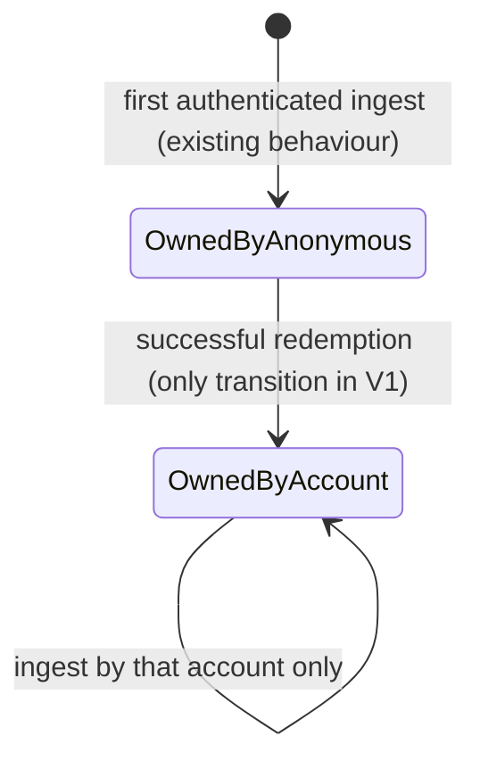

# Account System V1 — installation ownership claim protocol

Status: **specification (PR A)**; implemented in PR C (migration `0012`) and PR D (Companion). Nothing here is applied to any real database.

Goal: move `public.installations.owner_user_id` from the installation's current owner (typically an **anonymous** Supabase Auth UID) to a **verified registered** account, atomically, without touching a single observation, location, item, source or Guildbook row, and without any way to take over an installation by knowing its ID.

## 1. Design rules

1. **An installation ID is an identifier, never proof.** Redemption takes the *code only*; the installation is looked up from the claim.
2. **Only the current owner can issue a claim**, from its own JWT, and only an **anonymous** owner (a registered owner moving to a different account is a cross-account transfer and is out of V1).
3. **Only a registered, email-confirmed, active-session user can redeem.**
4. **128-bit code, 10-minute life, single use, hash only at rest** (SHA-256 of the 32-hex-character code; with 128 bits of entropy a plain digest is sufficient, no salt or pepper needed).
5. **One live code per installation:** issuing a new code revokes the previous pending one.
6. **Business failures are results, not exceptions.** A PostgreSQL exception rolls back the rate-limit counter written in the same transaction. Failures (wrong code, expired, replay, wrong owner) therefore return `{ok:false}` so the throttle and attempt counters persist. Exceptions are reserved for authentication/authorization (`PT401`/`PT403`) and budget exhaustion (`PT429`).
7. **One indistinguishable failure** (`invalid_claim` / `not_available`) for not-found, expired, consumed, revoked, owner-mismatch and unknown-installation, so there is no existence or state oracle.
8. **No plaintext codes, tokens or IPs** in tables, audit rows, logs or error messages.

## 2. State machines

### Claim

```mermaid
stateDiagram-v2
  [*] --> pending: claim_start (owner JWT, anonymous)
  pending --> consumed: claim_redeem (registered, rechecks owner)
  pending --> revoked: newer claim_start for the same installation
  pending --> revoked: 5 failed redeem attempts against this claim
  pending --> expired: now() > expires_at (lazy; never redeemable)
  consumed --> [*]
  revoked --> [*]
  expired --> [*]
```



Expiry is evaluated at redemption time (`expires_at > now()`). A periodic prune (which takes the installation advisory lock for each row it touches) deletes only **revoked and never-redeemed expired** claims older than 7 days and audit rows older than 180 days. **Consumed claims are never pruned**: the link row references them, and the `transferred` signal is derived from the link row's `previous_owner_uid`, which has no expiry.

### Installation ownership



There is deliberately no automatic transition back. Recovery is a documented, owner-approved, audited operator procedure (§7).

### Companion session

Two credentials can exist on one machine; they are stored in **two separate DPAPI slots** and never merged:

- the **primary session** (`session.dat`): `Anonymous` or `Registered`;
- the **legacy owner credential** (`legacy-owner.dat`): the anonymous session that still owns installations. It is created, not deleted, when a registered sign-in happens on a machine that has an anonymous session. It is used **only** for `claim_start`, `fdb_installation_link_status` and syncing installations that are still owned by that anonymous UID, and is removed only when every known installation has been transferred or the user explicitly chooses "forget the anonymous identity" after a warning that unclaimed installations will stop syncing. Without this slot, signing in first would strand every existing installation (the registered UID fails the ingest owner check and no claim could ever be started).

The kind of a stored session is its authenticated truth: the JWT's `is_anonymous` claim (set by Auth), never a flag the user or a file can forge. A plaintext, non-secret marker next to each blob (`kind=registered|anonymous`) exists only so an *unreadable* blob can still be classified; for sessions written by 0.8.x (no marker) the kind is read from the JWT claim.

| State | Meaning | Remote sync | Account features |
| --- | --- | --- | --- |
| `LoggedOut` | first run, or explicit sign-out of a registered account | off | off |
| `Anonymous` | explicit anonymous mode (today's behaviour) | on for installations it owns | off |
| `AnonymousClaiming` | anonymous with a pending claim shown | on until transfer | off |
| `Registered` | registered session; installations owned by this account | on for installations owned by the account; installations still owned by the legacy credential keep syncing through it | on |
| `ReauthRequired` | registered session unusable (refresh definitively rejected, blob unreadable with `kind=registered`, or ownership transferred and no registered session yet) | **off** for the account's installations; legacy-owned installations keep syncing | off |
| `AnonymousIdentityLost` | the anonymous refresh token was **definitively** rejected | off | off; no new anonymous identity is created without an explicit user confirmation that explains the consequence |

Transitions (all serialised by the single session gate; the gate must be machine-wide, a named `Mutex`, so two Companion instances cannot race):

| From | Event | To | Notes |
| --- | --- | --- | --- |
| `LoggedOut` | user chooses "Use without an account" | `Anonymous` | the only way an anonymous identity is ever created |
| `Anonymous` | registered sign-in succeeds | `Registered` | the anonymous session moves to the legacy slot, it is not discarded |
| `LoggedOut` | registered sign-in succeeds | `Registered` | no legacy slot |
| `Anonymous` | start claim | `AnonymousClaiming` | code shown once |
| `AnonymousClaiming` | status poll returns `transferred` | prompts sign-in if not `Registered` | message: "ownership moved to your account" |
| `Registered` | refresh succeeds | `Registered` | rotated refresh token persisted atomically |
| any | refresh fails with a **transient** error (offline, timeout, 5xx, storage `IOException`, parse error) | unchanged | **never** `Clear()`; retry later; sync pauses |
| `Registered` | refresh **definitively** rejected (HTTP 400/401 with `invalid_grant` / session not found) | `ReauthRequired` | never `Anonymous`; no identity is created |
| `Anonymous` | refresh **definitively** rejected | `AnonymousIdentityLost` | today this silently creates a new anonymous user and orphans the installations; that behaviour is removed |
| `Registered` | explicit sign-out | `LoggedOut` | server-side revoke with `scope=local` only (the website session is unaffected); local slot removed; **not** `Anonymous`; the legacy slot is kept |
| any | primary blob unreadable | state from the plaintext marker; `ReauthRequired` for `registered`; for `anonymous` or a missing marker, classify from the legacy blob/JWT, otherwise `LoggedOut` | corruption never downgrades identity |
| `Registered` | `fdb_installation_link_status` for an installation is not `owned` with the registered token | that installation's sync stays off | a different account is signed in; explain, never ingest |

Credential choice per installation: ask `fdb_installation_link_status` with the registered token first (`owned` ⇒ use it), then with the legacy token (`owned` ⇒ use it; `transferred` ⇒ prompt for registered sign-in); never create an owner implicitly.

Anonymous local collection (reading SavedVariables, local search and Guildbook view) keeps working in every state; only remote sync and account features are gated.

## 3. Schema (migration `0012_account_ownership_claims.sql`, private schema)

```sql
-- all objects in schema private; RLS enabled with no policies; ALL privileges revoked from public, anon, authenticated, service_role
create table private.installation_claims (
  id              uuid primary key default gen_random_uuid(),
  installation_id text not null references public.installations(id) on delete cascade,
  initiator_uid   uuid not null,                 -- the owner at issue time
  code_hash       bytea not null unique,         -- sha256(code); plaintext never stored
  status          text not null check (status in ('pending','consumed','revoked')),
  attempts        integer not null default 0,
  created_at      timestamptz not null default now(),
  expires_at      timestamptz not null,
  consumed_at     timestamptz,
  consumed_by     uuid
);
create unique index installation_claims_one_pending
  on private.installation_claims (installation_id) where status = 'pending';

create table private.account_installations (     -- provenance of a CLAIMED transfer (ownership itself is installations.owner_user_id)
  installation_id    text primary key references public.installations(id) on delete restrict,
  account_uid        uuid not null,
  linked_at          timestamptz not null default now(),
  claim_id           uuid not null references private.installation_claims(id),
  previous_owner_uid uuid not null                -- enables an audited manual restore
);
create index account_installations_account_idx on private.account_installations (account_uid);

create table private.account_audit (               -- minimal: no code, email, IP or token
  id              bigint generated always as identity primary key,
  at              timestamptz not null default now(),
  event           text not null check (event in ('claim_started','claim_redeemed','claim_revoked','redeem_rejected')),
  account_uid     uuid,
  installation_id text,
  claim_id        uuid
);
```

`public.installations` and every child table are **not altered**. **The source of truth for ownership remains `installations.owner_user_id`.** `account_installations` records provenance only (when, through which claim, from whom) and powers the `transferred` signal and the audited restore; installations first ingested by a registered Companion are owned by that account with no link row and are listed and authorised exactly like claimed ones. `on delete restrict` on the link prevents an installation delete from silently erasing the provenance record.

## 4. Function contracts (all `SECURITY DEFINER`, `set search_path = ''`, every object schema-qualified; `revoke all ... from public, anon, authenticated, service_role; grant execute ... to authenticated`)

Shared guards (in `private`, not callable by clients):

- `fdb_caller()` — role `authenticated`, `auth.uid()` not null (anonymous allowed) **and a live session**: the JWT carries a `session_id` and a row with that id and `user_id = auth.uid()` exists in `auth.sessions` and is not expired (`not_after` null or in the future); the user exists, `deleted_at is null`, `banned_until` null or past. A JWT without `session_id` is refused (fail closed). **This applies to every account function, including `fdb_account_claim_start` for the anonymous owner**: Auth access tokens stay cryptographically valid until `exp` after sign-out or revocation, so without a live-session check a stolen but *revoked* anonymous token could still mint a claim code and permanently move the installation to an attacker's account.
- `fdb_registered_caller()` — everything in `fdb_caller()` **plus** `auth.users.is_anonymous = false` and `email_confirmed_at is not null`. A captured registered token is therefore also useless as soon as its session is revoked. (Checked against real GoTrue in the CI and staging suites; `auth.sessions` semantics and the presence of `session_id` in anonymous-session JWTs are the Supabase-version dependencies, so the migration's pre-flight asserts the table and columns and the CI suite asserts the claim on a real anonymous token.)

| Function | Caller | Behaviour |
| --- | --- | --- |
| `fdb_account_claim_start(p_installation_id text) → jsonb` | current owner, **anonymous**, with a **live session** (`fdb_caller()`) | validate id shape; take the per-**uid** budget `claim_start:uid:<uid>` (3 per 300 s) and the global ceiling; `pg_advisory_xact_lock(hashtextextended(id,0))` (**same key as ingest**); `select … from public.installations where id = $1 for update`; owner must equal `auth.uid()` and the caller must still be anonymous (`auth.users.is_anonymous`); **only then** charge the per-installation budget (key `claim_start:inst:` ‖ first 32 hex of `sha256(id)`: the existing budget function rejects keys over 140 characters and installation IDs may be 128, and charging before the owner check would let anyone who knows an ID exhaust the owner's budget); revoke the previous pending claim (audit `claim_revoked`); generate `upper(encode(extensions.gen_random_bytes(16),'hex'))`, store `sha256(code)`, `expires_at = now()+10 min`; audit `claim_started`; return `{ok:true, code, expires_at}`. Any precondition failure returns `{ok:false,error:'not_available'}`. |
| `fdb_account_claim_redeem(p_code text) → jsonb` | **registered** | `fdb_registered_caller()`; budgets `claim_redeem:uid:<uid>` 10 per 300 s and the global ceiling; format check `^[0-9A-F]{32}$`; hash; look up the claim by hash (no lock) → none ⇒ audit `redeem_rejected`, `{ok:false,error:'invalid_claim'}`; take the **advisory lock for the claim's installation**; re-select the claim `for update` and the installation `for update`; require `status='pending' and expires_at > now()`, installation exists, `owner_user_id = claim.initiator_uid`, **the initiator is still anonymous** (`auth.users.is_anonymous` — an owner that upgraded itself to a permanent account between start and redeem must not be movable by a leaked code), **the initiator still exists, is not banned or deleted and still has a live session** (so revoking or deleting the owner identity cancels its pending claims), `auth.uid() <> initiator_uid`; otherwise increment `attempts` (revoke at 5), audit, `{ok:false,error:'invalid_claim'}`. If the claim is valid but the account already owns 50 installations, return `{ok:false,error:'account_limit'}` **without consuming the code** (only a caller holding a valid code learns this). Then **in the same transaction** set `installations.owner_user_id = auth.uid()`, insert `account_installations (previous_owner_uid = initiator_uid)`, mark the claim `consumed`, audit `claim_redeemed`; return `{ok:true, installation_id, linked_at}`. |
| `fdb_installation_link_status(p_installation_id text) → jsonb` | any authenticated | gated by the existing `foreverdb_api_gate('detail')` (existing per-UID read budgets; no new quota). `{state:'owned'}` if the caller is the installation's owner; `{state:'transferred'}` if `account_installations.previous_owner_uid = auth.uid()` for that installation (never pruned, so a Companion offline for months still learns it); otherwise `{state:'unknown'}`. |
| `fdb_account_installations() → setof` | registered | gated by `foreverdb_api_gate('detail')`; installations where `installations.owner_user_id = auth.uid()` (claimed or first-ingested by this account); max 50 rows; `linked_at` is the link's `linked_at` or the installation's `first_seen_at`; columns `installation_id, linked_at, last_seen_at, guild_count` only. |
| `fdb_account_guildbook_guilds(p_installation_id text)` | registered | gated by `foreverdb_api_gate('detail')`; ownership re-derived in SQL (`installations.owner_user_id = auth.uid()`); returns an **empty set** for installations not owned (indistinguishable from owned-but-empty); no `member_guid`. |
| `fdb_account_guildbook_members(p_installation_id, p_guild_key, p_limit, p_offset)` | registered | same gate and ownership derivation; `p_limit` clamped to 1..200, `p_offset` 0..100000; stable order `(rank_index, member_name)`; selected columns exclude `installation_id` and `member_guid`. PR C extends the registry with a professions function after reviewing its columns. |

All six functions set `lock_timeout = '5s'` (a redeem can queue behind a 15-second ingest and must fail cleanly rather than hang). Wrong-code guesses cannot be charged to a claim (nothing matches), so the per-redeemer budget is the control; `attempts` only counts failed re-validations against a *found* claim.

Contracts for these are frozen in `web/src/lib/account/contracts.ts` (PR A). Quotas are the **existing** ones; no registered tier exists in V1. A registered UID shares one per-UID budget across all of its installations (e.g. ingest 5 per 300 s per UID), a known limitation recorded for the later tiering milestone.

### Grants and hygiene checklist (asserted by the SQL suite)

- No `SELECT/INSERT/UPDATE/DELETE` privilege on any `private.*` table for `public/anon/authenticated/service_role`.
- `has_function_privilege('anon', …, 'execute') = false` for all six functions; `authenticated` true; `public` false.
- `prosecdef = true`, `proconfig` contains `search_path=`, owner is the migration role.
- No dynamic SQL; every reference schema-qualified (`public.`, `private.`, `auth.`, `extensions.`).
- Existing functions (ingest, search, stats, F-3 denominators) are **not modified** (byte-identical `prosrc` hash before and after).

## 5. Concurrency

Every function that touches a claim or an installation's ownership first takes **`pg_advisory_xact_lock(hashtextextended(installation_id, 0))`**, the exact key the private ingest implementation takes (`0005`: `perform pg_advisory_xact_lock(hashtextextended(installation, 0))`), and only then row locks (`claim` then `installation` in redeem, `installation` then `claim` in start). The row-lock orders differ, which is safe only because the advisory lock serialises everything per installation; therefore **any future code that locks these rows without the advisory lock (including the prune job) breaks the guarantee** and must not exist. (Ingest charges its budget rows before the advisory lock inside the private implementation; budgets are keyed by UID, not installation, so they cannot form a cycle with these locks.) `lock_timeout` bounds waiting.

| Race | Outcome |
| --- | --- |
| Two accounts redeem the same code simultaneously | Both read the claim; the advisory lock serialises; the second re-reads under `for update`, sees `consumed`, returns `invalid_claim`. Exactly one owner. |
| Same account redeems twice at once | Second gets `invalid_claim` (replay). |
| `claim_start` while a redeem runs | Serialised; if start wins, the old claim is `revoked` and the redeem fails; if redeem wins, start sees a non-anonymous owner and returns `not_available`. |
| Ingest running during redeem | Ingest holds the advisory lock for its whole transaction; redeem waits, the snapshot lands under the old owner, then ownership flips. No lost or duplicated rows (children are keyed by `installation_id`, untouched). |
| Anonymous ingest after redeem | Rejected by the existing owner check; no new identity or row is created. |
| Redeem for an installation deleted after the claim | `on delete cascade` removes a pending claim; the lookup finds nothing: `invalid_claim`. (A *consumed* claim is protected by the link's `on delete restrict`.) |
| Owner upgrades itself to a permanent account between start and redeem | redeem rechecks `is_anonymous` for the initiator: `invalid_claim`; a leaked code cannot move a registered owner's installation. |
| Cheap accounts exhaust the global claim ceilings | accepted residual (denial of the claim feature only, never of ingest or reads); upstream Auth per-IP limits and the per-uid budgets apply; the ceilings are alarms |

## 6. Failure modes

| Failure | Result |
| --- | --- |
| Wrong/unknown code | `invalid_claim`; redeemer's budget charged (10 per 5 min); audit `redeem_rejected` with no code. Guessing 2^128 is infeasible at that rate. |
| Expired code | `invalid_claim`. |
| Revoked-but-unexpired anonymous access token (owner UID still matches) | `claim_start` refuses it: no live `auth.sessions` row for the JWT's `session_id`. Required SQL negative test (PR C), including the case where the owner UID still equals `installations.owner_user_id`, and the same for redeem by a revoked registered token. |
| Leaked installation ID | useless: no function accepts an installation ID as redemption proof; `claim_start` requires being the owner. |
| Attacker with someone's **active** anonymous bearer token (the Companion's session) | **V1 adds lasting power here.** Today such an attacker can ingest as that identity but cannot change who owns anything. With claims, an *active* stolen bearer can start a claim and transfer the installation permanently to the attacker's own registered account. Mitigations: a *revoked* or deleted/banned session cannot start or complete a claim (live-session check, negative test required in PR C); the code is short-lived and single-use; every claim is audited and the previous owner is recorded; the legitimate Companion sees `transferred` and re-authentication is required. Residual risk is accepted for V1 and documented: the window is the lifetime of an undetected, still-active token, and recovery is the owner-approved restore runbook below. A registered victim's installations are not claimable (owner not anonymous). |
| Network drop after commit | Companion polls `fdb_installation_link_status`; the idempotent `transferred`/`owned` answer resolves the ambiguity. |
| Companion loses its session file after the transfer | `ReauthRequired`; sign in; never a new anonymous owner. |
| User signs into the wrong account | status `unknown`; installation sync stays off; explained in UI. |

## 7. Deployment safety, rollback and incident recovery

**Pre-flight** (`do $$` block that raises, read-only): ledger shows `0011` and not `0012`; `private` schema, `private.foreverdb_take_budget`, `private.foreverdb_api_gate` exist; `extensions.gen_random_bytes` and `extensions.digest` exist (`pgcrypto`); `auth.users` and `auth.sessions` have the columns used and `has_table_privilege` confirms the migration role can read both (Supabase's `auth.sessions.not_after` is usually null, so only a non-null past value counts as expired); the ingest owner check text is present; reports (does not fail on) ownerless installations. **Idempotent** (`create … if not exists`, `create or replace`), forward-only, new ledger entry `account_ownership_claims`. After every `create function` the migration explicitly revokes `execute` from `public`, `anon`, `authenticated` and `service_role` and then grants `authenticated` only, because Supabase default privileges can re-grant on new functions. `0010` is untouched and not applied.

**Numbering policy.** The repository file number orders review; the production ledger records timestamped names. `0010` (public projection export) is reserved and unapplied; `0011` is applied; `0012` is next. Applying `0012` before `0010` is safe because they are independent (the pre-flight does not require `0010` and `0010` does not require `0012`). The migration never reuses or renumbers `0010`.

**Why pgcrypto.** `gen_random_uuid()` is a v4 UUID with only 122 random bits and fixed nibbles, below the 128-bit requirement; `extensions.gen_random_bytes` is the straightforward CSPRNG and ships in the Supabase `extensions` schema. The pre-flight asserts it exists.

**Post-apply verification** (read-only): six functions present with expected ACLs; tables empty; ingest/search/stats `prosrc` hashes unchanged; anon denied; one smoke claim in a throwaway database, never in production data.

**Rollback** (`database/rollback/0012_…sql`): kill switch first (`revoke execute … from authenticated` on the claim functions, instantly stopping new claims and redemptions without dropping anything); full rollback drops the six functions and, only if `account_installations` is empty, the tables. **It never moves ownership and never deletes observation data.** If links exist, they are retained (ownership is already stored in `installations.owner_user_id`).

**Incident recovery** (mistaken or malicious claim): operator-run, owner-approved SQL, never automatic: look up `account_installations.previous_owner_uid` for the installation, take the ingest advisory lock, set `installations.owner_user_id` back, delete the link, insert an audit row, and rely on the Companion's `ReauthRequired`/status flow. The runbook ships with PR C and is rehearsed in the SQL suite on a throwaway database.

## 8. Anonymous→permanent UID upgrade (evaluated, not used)

Supabase can upgrade an anonymous user in place (`updateUser` with email/password), keeping the UID and therefore all ownership with **no transfer**. It is attractive for a future optimisation but unsuitable as the V1 basis: the website-first user has no anonymous session to upgrade (the account is created on the web, the installation's owner UID lives only in the Companion), it would silently convert anonymous users (forbidden), and it cannot attach two installations owned by different anonymous UIDs to one account. The claim protocol covers all three cases, so the optimisation is recorded as future work.
