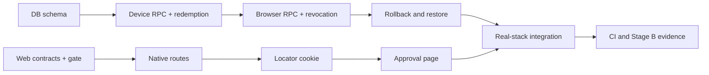

# Browser Pairing V1 Stage B Implementation Plan

> **For agentic workers:** REQUIRED SUB-SKILL: Use superpowers:subagent-driven-development (recommended) or superpowers:executing-plans to implement this plan task-by-task. Steps use checkbox (`- [ ]`) syntax for tracking.

**Goal:** Implement migration 0016, the fixed Browser Pairing RPC/API surface, and the Account approval page with executable database, web, and real-GoTrue integration evidence while every release gate remains off.

**Architecture:** PostgreSQL owns pairing state, exact-session authorization, ownership transfer, device registration, throttling, audit, and revocation. The Next.js Account boundary remains an unprivileged publishable-key BFF: native endpoints forward the Companion's anonymous bearer to three fixed RPCs, while the page and two browser mutations use the existing server-held registered session. Stage B uses a protocol test client for the Companion side; DPAPI storage, polling UI, browser launch, and WPF state handling remain Stage C.

**Tech Stack:** PostgreSQL 16, PL/pgSQL, Supabase GoTrue v2.197.0, PostgREST v12.2.12, Node.js 24, Next.js 16.4, TypeScript 5.9, Zod 3, Vitest 3, Playwright 1.63, GitHub Actions.

**Spec:** `docs/superpowers/specs/2026-10-16-browser-pairing-v1-design.md` and its normative documents, approved on 2026-10-16 in Draft PR #62 at commit `7453e487f25dd5bb58e261b26e55c6222a7668d1`.

## Global Constraints

- Implement on `feature/browser-pairing-v1` in Draft PR #62; do not merge, deploy, publish, or modify a live Supabase project.
- PR #58 owns `0015_azerdex_welcome_outbox.sql`; Browser Pairing owns `database/migrations/0016_browser_pairing.sql`. Migration 0016 requires 0012 and 0014 and must not depend on 0015 objects.
- `public.installations.owner_user_id` remains the only ownership authority. Do not modify `private.account_installations`, `private.account_audit`, or existing 0012/0014 function bodies.
- The database config defaults false. `BROWSER_PAIRING_WEB_APPROVED`, all existing Account/pilot/production approvals, and `DeviceAutoSyncApproved` remain literal `false` in every commit.
- Local disposable tests may explicitly enable the private database config and use the already-restricted non-hosted `ACCOUNT_AUTH_MODE=local`; no environment variable may enable pairing on staging, pilot, or production while the source approval is false.
- The BFF may use only the publishable key and caller token. No service role, database password, generic RPC forwarder, token in browser JavaScript, or secret in a URL/log is permitted.
- Pairing lifetime is at most five minutes. Poll interval starts at 5 seconds and may rise by 5 seconds to a maximum of 30 seconds.
- The global lock order, terminal/retryable failure classes, exact initiator and approver session rules, re-enrollment predicate, audit contract, and rollback outcomes in the Stage A state-machine and migration documents are mandatory.
- Stage B does not add Companion product code. It freezes and proves the HTTP/SQL contract that Stage C will consume.
- Target date is 2026-10-30; no date waives a security, data-preservation, Windows, or release gate.

## Review Focus

- A wrong locator, poll secret, UID, or same-UID/different-session token must not change the pairing row, per-pair budget, interval, or `next_poll_at`; Task 2 adds byte-for-byte tests.
- Logout, refresh-family revocation, and concurrent session revocation must win or lose at the documented row-lock boundary for start, cancel, approve, deny, and redemption without partial pairing/ownership/device writes; Tasks 2, 3, and 9 add real-GoTrue race tests.
- A nonempty rollback must retain the full provenance schema and revocation trigger so a device revoked while APIs are absent cannot leave a connected pairing; Task 4 tests this lifecycle.
- A known locator may select a request, but cookie forgery, stale-tab action, automatic CSRF retry after account switching, and cross-origin mutation must fail before an RPC; Tasks 7 and 8 pin this behavior.
- Two approvals or two valid redemption polls must commit one account, one owner change, one device, one transition audit, and no duplicate history; Tasks 2, 3, and 9 run concurrent transactions.

---

## File Map

| Unit | Files | Responsibility |
| --- | --- | --- |
| Pairing migration | `database/migrations/0016_browser_pairing.sql` | Closed schema, provenance, audit, exact-session guards, six RPCs, atomic redemption, revocation trigger, gate false |
| Pairing operations | `database/ops/0016_*.sql`, `database/rollback/0016_*.sql`, `database/restore/0016_browser_pairing_restore.sql` | Ledger, enable/disable, kill switch, two-outcome rollback, forward restore |
| SQL test world | `database/tests/pairing/*.mjs`, `database/tests/account/stack.sh` | Disposable schema, direct RPC fixtures, concurrency, mutation, GoTrue, rollback, compatibility |
| Web contracts | `web/src/lib/account/contracts-pairing.ts`, `web/src/lib/account/rpc-client.ts`, `web/src/lib/account/pairing-gate.ts` | Strict RPC schemas, closed allowlists, false source gate |
| Native boundary | `web/src/lib/account/pairing-native.ts`, `web/src/app/account/api/device-pair/{start,poll,cancel}/route.ts` | Bearer-only native requests, bounded JSON, fixed error mapping |
| Browser binding | `web/src/lib/account/pairing-cookie.ts`, `web/src/lib/account/crypto.ts`, `web/src/proxy.ts` | Signed short-lived locator cookie, clean redirect, intake headers, rate-limit classification |
| Approval UI | `web/src/app/account/device-pair/page.tsx`, `web/src/app/account/_components/DevicePairApproval.tsx`, `web/src/app/account/api/device-pair/{approve,deny}/route.ts` | Preview, account-named confirmation, approve/deny, account-switch refusal |
| Web tests | `web/tests/unit/account-pairing-*.test.ts`, `web/tests/account-e2e/{09,10,11,12}-browser-pairing*.spec.ts` | Unit, static, real-stack browser, PostgREST, session-lifecycle, and security evidence |
| CI and evidence | `.github/workflows/account-ownership-sql.yml`, `.github/workflows/account-e2e-integration.yml`, `scripts/check-pilot-flags.py`, Stage B docs | Required executable gates, exact-head evidence, OFF-state enforcement |

## Ordered Workstreams



Database Tasks 1–4 are sequential because they edit one migration and share lock invariants. Web Task 5 may begin in parallel with Task 1 because the six RPC signatures are frozen below. Web Tasks 6–8 are sequential to avoid conflicting edits to the closed RPC client and proxy. Task 9 begins only after both workstreams are green. CI scaffolding from Task 10 may be prepared after test filenames are fixed, but its final commit waits for Task 9 commands to pass.

### Task 1: Create the closed pairing schema and OFF-by-default gate

**Files:**
- Create: `database/migrations/0016_browser_pairing.sql`
- Create: `database/tests/pairing/world.mjs`
- Create: `database/tests/pairing/01_schema.test.mjs`
- Modify: `database/tests/account/stack.sh`

**Interfaces:**
- Consumes: migration 0012 guards/installation lock conventions and migration 0014 `private.devices` schema.
- Produces: `private.device_pairing_config`, `private.device_pairings`, `private.device_pairing_audit`, nullable `private.devices.pairing_id`, the exactly-one ticket/pairing provenance constraint, and `stack.sh apply16`.

- [ ] **Step 1: Write the failing schema and closure tests**

In `01_schema.test.mjs`, assert exact columns/types/checks/indexes from `browser-pairing-state-machine.md`, FORCE RLS with zero policies/client table grants, the seven-event audit allowlist, its two partial uniqueness rules, and `enabled = false`. Assert `private.account_installations`, `private.account_audit`, and every 0012/0014 function definition/ACL hash are unchanged.

- [ ] **Step 2: Add migration-order RED cases**

Assert the migration is named 0016, refuses missing 0012/0014, does not require an 0015 object, accepts a ledger containing PR #58's `azerdex_welcome_outbox` entry, and does not record or enable itself.

- [ ] **Step 3: Run RED verification**

Run: `node --test --test-concurrency=1 database/tests/pairing/01_schema.test.mjs`

Expected: FAIL because `private.device_pairings` and `stack.sh apply16` do not exist.

- [ ] **Step 4: Implement the minimal schema transaction**

Add preflight, tables, constraints, indexes, RLS/ACL closure, device provenance extension, fixed function timeouts/search paths, postconditions, and `notify pgrst, 'reload schema'`. Generate `audit_ref` server-side; never copy the public locator into pairing audit. Do not create public RPCs yet.

- [ ] **Step 5: Run GREEN verification**

Run the disposable stack through `up`, `apply`, `apply14`, `apply16`, then run `01_schema.test.mjs`.

Expected: PASS; config false; old object hashes and historical rows are unchanged.

- [ ] **Step 6: Commit**

Commit message: `feat(database): add closed browser pairing schema`

### Task 2: Implement native pairing RPCs and atomic single-use redemption

**Files:**
- Modify: `database/migrations/0016_browser_pairing.sql`
- Modify: `database/tests/pairing/world.mjs`
- Create: `database/tests/pairing/02_device_rpc.test.mjs`
- Create: `database/tests/pairing/03_redemption_concurrency.test.mjs`

**Interfaces:**
- Consumes: Task 1 tables, `private.fdb_anonymous_caller()`, `private.foreverdb_take_budget(...)`, installation advisory lock, and 0014 device constraints.
- Produces:
  - `public.fdb_device_pair_start(p_pairing_id uuid, p_poll_secret_hash text, p_device_id uuid, p_device_credential_hash text, p_installation_id text, p_computer_name text) returns jsonb`
  - `public.fdb_device_pair_poll(p_pairing_id uuid, p_poll_secret text) returns jsonb`
  - `public.fdb_device_pair_cancel(p_pairing_id uuid, p_poll_secret text) returns jsonb`

- [ ] **Step 1: Write failing start/poll/cancel tests**

Cover canonical UUID/hash/label validation, five-minute expiry, idempotent identical start, changed-binding conflict, one live request per installation/initiator, exact anonymous UID/session, pending polling, valid early-poll backoff, cancel, expiry, feature-disabled behavior, and terminal idempotency. Pin the authoritative five-minute-window budgets and isolated keys: start is 5 per UID, 3 per installation hash, and 120 globally; poll is 90 per UID, the state-machine pair schedule, and 3000 globally; cancel is 10 per UID, 5 per pair, and 120 globally. Assert one actor cannot spend another actor's UID, installation, or pair bucket.

- [ ] **Step 2: Pin invalid-proof side effects**

For wrong locator, secret, UID, registered token, and another session of the same anonymous UID, snapshot the pairing row, pairing-specific budget rows, interval, `next_poll_at`, owner, devices, and audit; assert byte-for-byte equality after refusal. Principal/global budget use is the only allowed change.

- [ ] **Step 3: Write failing redemption and concurrency tests**

Insert an approved fixture through the same locked invariants and cover new installation, anonymous-owner transfer, missing-installation placeholder, two simultaneous valid polls, poll/cancel race, lost-response replay, owner conflict, device-ID collision, retryable account/device limits, and transaction rollback after injected constraint failure. Assert one owner change, `previous_owner_uid`, device, connected transition, and `pairing_connected` audit.

- [ ] **Step 4: Run RED verification**

Run: `node --test --test-concurrency=1 database/tests/pairing/02_device_rpc.test.mjs database/tests/pairing/03_redemption_concurrency.test.mjs`

Expected: FAIL because the three RPCs are absent.

- [ ] **Step 5: Implement the three RPCs**

Follow the twelve-class global lock order exactly. In start, cancel, and redemption, re-run `private.fdb_anonymous_caller()` and lock the exact `auth.sessions` row `FOR SHARE` after the installation advisory lock; the first caller check is insufficient after any lock wait. Hash the submitted secret with SHA-256 and compare only the fixed-length digest; never store or compare a raw secret. Pair-specific budget/interval writes occur only after actor and secret proof. Redemption locks/revalidates the exact approving session, account, installation, predecessor/device rows, then writes owner/provenance/device/connected/audit in one transaction.

- [ ] **Step 6: Run GREEN and deadlock verification**

Run the two files repeatedly with `--test-concurrency=1`; inside `03_redemption_concurrency.test.mjs`, execute at least 100 paired races and fail on timeout, duplicate row, partial write, or deadlock.

Expected: all pass; a repeat connected poll performs zero writes.

- [ ] **Step 7: Commit**

Commit message: `feat(database): add atomic browser pairing redemption`

### Task 3: Implement browser approval, controlled re-enrollment, revocation, and audit

**Files:**
- Modify: `database/migrations/0016_browser_pairing.sql`
- Modify: `database/tests/pairing/world.mjs`
- Create: `database/tests/pairing/04_account_rpc.test.mjs`
- Create: `database/tests/pairing/05_reenrollment_revocation.test.mjs`
- Create: `database/tests/pairing/06_audit.test.mjs`
- Create: `database/tests/pairing/07_mixed_concurrency.test.mjs`

**Interfaces:**
- Consumes: Task 2 state/redemption functions and `private.fdb_registered_caller()`.
- Produces:
  - `public.fdb_account_device_pair_preview(p_pairing_id uuid) returns jsonb`
  - `public.fdb_account_device_pair_approve(p_pairing_id uuid) returns jsonb`
  - `public.fdb_account_device_pair_deny(p_pairing_id uuid) returns jsonb`
  - an `AFTER UPDATE OF status` trigger on `private.devices` that propagates every linked device revocation.

- [ ] **Step 1: Write failing preview/approve/deny authorization tests**

Assert confirmed registered exact-session callers only; sanitized preview fields only; no initiator/session/device/full-installation/account-winner disclosure; approval stores caller UID and JWT session ID; ownership/device remain unchanged before poll; same approving account may deny; concurrent two-account approval, approve/deny, and approve/expiry races have one winner. Pin the authoritative five-minute-window budgets and isolated keys: preview is 30 per UID, 60 per pair, and 600 globally; approve and deny share one budget of 10 per UID, 5 total per pair, and 120 globally. Assert approve cannot evade deny's pair budget or spend another UID/pair bucket.

- [ ] **Step 2: Write the complete re-enrollment matrix**

Test no-active-device, latest predecessor, same installation/current account/initiator UID, revoked state, and allowed reason in `{owner_revoked, credential_reuse, replaced}`. Mutate one predicate at a time and assert generic refusal with no owner/device change. Assert success inserts a fresh active device and never resurrects a credential.

- [ ] **Step 3: Write revocation and audit tests**

Drive owner revoke, retired-credential reuse, and same-identity replacement through existing 0014 RPCs; assert the trigger changes the linked pairing to revoked in the same transaction. Assert exactly one fixed transition audit, at most one deferred audit per limit reason, and no audit for invalid proof, early poll, gate, rate, or infrastructure failure.

- [ ] **Step 4: Write bounded mixed-protocol concurrency tests**

In `07_mixed_concurrency.test.mjs`, repeatedly race pairing start and redemption against existing claim transfer, ticket enrollment, manual ingest, and device revoke paths. Give every race a hard timeout and assert no deadlock, exactly one valid serialization, unchanged lock order, and no partial ownership, device, provenance, pairing, or audit write. Cover both acquisition orders and at least 100 iterations per pairing/existing-protocol combination.

- [ ] **Step 5: Run RED verification**

Run: `node --test --test-concurrency=1 database/tests/pairing/04_account_rpc.test.mjs database/tests/pairing/05_reenrollment_revocation.test.mjs database/tests/pairing/06_audit.test.mjs database/tests/pairing/07_mixed_concurrency.test.mjs`

Expected: FAIL because the browser RPCs and trigger are absent.

- [ ] **Step 6: Implement browser RPCs and trigger**

Use the current `auth.uid()` and JWT `session_id` only; accept no account identity parameter. For approve and deny, repeat the registered-caller check and lock the exact `auth.sessions` row `FOR SHARE` after the installation advisory lock so revocation during a wait cannot mutate the pairing. Apply database-clock expiry under lock, generic losing-account responses, exact approving-session revalidation at redemption, terminal/retryable failure rules, and the complete predecessor predicate. Keep 0014 functions byte-identical.

- [ ] **Step 7: Run GREEN verification and all SQL pairing tests**

Run: `node --test --test-concurrency=1 database/tests/pairing/0[1-7]_*.test.mjs`

Expected: all pass with no deadlock and no duplicate transition audit.

- [ ] **Step 8: Commit**

Commit message: `feat(database): add browser pairing approval controls`

### Task 4: Add kill switch, rollback, restore, ledger, compatibility, and mutation proofs

**Files:**
- Create: `database/ops/0016_record_migration_ledger.sql`
- Create: `database/ops/0016_enable_browser_pairing.sql`
- Create: `database/ops/0016_disable_browser_pairing.sql`
- Create: `database/rollback/0016_kill_switch.sql`
- Create: `database/rollback/0016_kill_switch_restore.sql`
- Create: `database/rollback/0016_rollback.sql`
- Create: `database/restore/0016_browser_pairing_restore.sql`
- Modify: `database/rollback/0014_rollback.sql`
- Modify: `database/rollback/0012_rollback.sql`
- Create: `database/tests/pairing/08_rollback_restore.test.mjs`
- Create: `database/tests/pairing/09_compatibility.test.mjs`
- Create: `database/tests/pairing/mutation_check.mjs`

**Interfaces:**
- Consumes: complete 0016 object registry from Tasks 1–3.
- Produces: append-only ledger cycle `browser_pairing -> rollback_browser_pairing -> browser_pairing_restore`, reversible kill switch, and the two exact rollback outcomes from Stage A.

- [ ] **Step 1: Write failing operational lifecycle tests**

Cover config enable/disable preconditions, EXECUTE revocation/restoration, empty rollback/full-schema restore, nonempty rollback retaining complete schema/trigger, refusal of mixed schema, one-use ledger cycle, and immutable ownership/history hashes. Add preflight-only guards to the existing 0014 and 0012 rollback scripts: refuse while a pending pairing row, connected pairing device, retained nonempty pairing audit/provenance row, or any 0016 retained schema dependency exists, and instruct the operator to run the 0016 kill switch/rollback first. Do not change their migration or function bodies. Test each blocker independently and the clean reverse-order success path.

- [ ] **Step 2: Pin revocation during rollback**

Connect a pairing device, perform nonempty rollback, revoke it through an existing 0014 path while pairing RPCs are absent, assert the retained trigger marks the pairing revoked, then restore and assert rows are untouched and the gate is still false.

- [ ] **Step 3: Add 0014, claims, and PR #58 ordering cases**

Run ticket enrollment and claim transfer before/after 0016. Test `0012 -> 0014 -> 0016` with and without a ledger row named `azerdex_welcome_outbox`; after PR #58 lands on `main`, the final rebase gate also applies the real `0015` file between 0014 and 0016.

- [ ] **Step 4: Run RED verification**

Run: `node --test --test-concurrency=1 database/tests/pairing/08_rollback_restore.test.mjs database/tests/pairing/09_compatibility.test.mjs`

Expected: FAIL because operational files do not exist.

- [ ] **Step 5: Implement operations and restore**

Every script preflights exact object hashes/ACLs and aborts atomically. The empty restore rebuilds all schema; the retained restore requires the complete schema and live trigger, verifies revoked-device/pairing consistency, recreates only API helpers/RPCs, grants `authenticated` only, and leaves config false.

- [ ] **Step 6: Add mutation coverage**

Mutation tests must fail when removing gate checks, RLS/FORCE RLS, grants, exact session comparison, refresh-token liveness, owner/re-enrollment predicates, lock classes/order, expiry, secret proof, state predicate, unique constraints, trigger propagation, audit bounds, or rollback/restore preconditions.

- [ ] **Step 7: Run GREEN verification**

Run the full `database/tests/pairing/*.test.mjs` suite and `node database/tests/pairing/mutation_check.mjs`.

Expected: all functional tests and every mutant-kill assertion pass.

- [ ] **Step 8: Commit**

Commit message: `feat(database): add browser pairing recovery lifecycle`

### Task 5: Freeze web contracts, closed RPC clients, and the false source gate

**Files:**
- Create: `web/src/lib/account/contracts-pairing.ts`
- Create: `web/src/lib/account/pairing-gate.ts`
- Modify: `web/src/lib/account/rpc-client.ts`
- Modify: `scripts/check-pilot-flags.py`
- Create: `web/tests/unit/account-pairing-contracts.test.ts`
- Create: `web/tests/unit/account-pairing-static.test.ts`
- Modify: `web/tests/unit/account-boundary.test.ts`

**Interfaces:**
- Consumes: the six SQL signatures from Tasks 2–3 and existing strict Zod/RPC result patterns.
- Produces: `PAIRING_RPCS`, `NATIVE_PAIRING_RPCS`, `ACCOUNT_PAIRING_RPCS`, literal `BROWSER_PAIRING_WEB_APPROVED = false`, and these exact typed boundaries:
  - `browserPairingWebAvailable(ac: Pick<AccountContext, "cfg" | "env">, approval?: boolean): boolean`
  - `callNativePairingRpc<N extends NativePairingRpcName>(cfg: AccountAuthConfig, name: N, input: PairingRpcInput<N>, accessToken: string): Promise<PairingRpcResult<N>>`
  - `callAccountPairingRpc<N extends AccountPairingRpcName>(cfg: AccountAuthConfig, name: N, input: PairingRpcInput<N>, accessToken: string): Promise<PairingRpcResult<N>>`

- [ ] **Step 1: Write failing strict-contract tests**

Encode exact request/response schemas and fixed errors from `browser-pairing-api-contract.md`. Reject extra keys, wrong casing, noncanonical UUIDs, bad hashes/secrets, oversized labels, unknown states/errors, and secret-bearing browser preview/output fields.

- [ ] **Step 2: Write failing closed-client/static tests**

Assert the three native and three account RPCs are disjoint allowlists, no other function can be named, account routes cannot call native RPCs, only `rpc-client.ts` builds `/rest/v1/rpc/`, redirects are manual, responses bounded/no-store, and logs/bundles cannot contain caller tokens or pairing secrets.

- [ ] **Step 3: Write gate tests**

Assert `browserPairingWebAvailable` returns true only for a non-hosted validated `local` Account context or an injected/compiled approval. Hosted staging/pilot/production refuse while the compiled source constant is false. The disposable stack must still enable the independent database gate explicitly. Extend `check-pilot-flags.py --require-off` so changing the source constant or the migration's default-false config fails.

- [ ] **Step 4: Run RED verification**

Run: `cd web && npx vitest run tests/unit/account-pairing-contracts.test.ts tests/unit/account-pairing-static.test.ts tests/unit/account-boundary.test.ts`

Expected: FAIL because the registry and gate are absent.

- [ ] **Step 5: Implement contracts and typed calls**

Refactor only the shared bounded POST machinery inside `rpc-client.ts`; preserve existing Account/enrollment exports and behavior. Expose separate native/account typed functions so a handler cannot accidentally select the other actor's RPC.

- [ ] **Step 6: Run GREEN verification**

From `web/`, run the focused tests plus all existing `tests/unit/account-*.test.ts`, then return to the repository root and run `python3 scripts/check-pilot-flags.py --require-off`.

Expected: all pass; the root-level flag scan lists the new source gate as false.

- [ ] **Step 7: Commit**

Commit message: `feat(web): add closed browser pairing contracts`

### Task 6: Implement the bearer-only native pairing endpoints

**Files:**
- Create: `web/src/lib/account/pairing-native.ts`
- Create: `web/src/app/account/api/device-pair/start/route.ts`
- Create: `web/src/app/account/api/device-pair/poll/route.ts`
- Create: `web/src/app/account/api/device-pair/cancel/route.ts`
- Modify: `web/src/lib/security/rate-limit.ts`
- Modify: `web/src/proxy.ts`
- Create: `web/tests/unit/account-pairing-routes.test.ts`

**Interfaces:**
- Consumes: Task 5 native RPC client, `accountRuntime()`, bounded JSON reader, fixed HTTP response helpers.
- Produces: `nativePairingApi<B>(options, handler)` plus the exact three POST endpoints. Start adds `verificationUri` from the validated site origin; poll/cancel never return a credential.
- Consumes the Task 5 source gate before request parsing, authentication, or RPC selection.

- [ ] **Step 1: Write failing native-boundary tests**

Test valid bearer-only requests and refuse missing/duplicate/malformed authorization, registered caller, cookies as identity, wrong content type, oversized/duplicate-key/extra-key JSON, redirecting PostgREST, and foreign/literal-null Origin. A native request with neither Origin nor Fetch Metadata is valid; no CORS header is emitted. In hosted staging, pilot, and production contexts, the literal-false source gate returns the existing 404/refusal for start, poll, and cancel before body parsing or authentication and makes zero RPC calls.

- [ ] **Step 2: Pin HTTP/error behavior**

Assert 401 for dead/session-not-accepted, 400 invalid request, 409 pairing/installation/device conflict, 429 with bounded `Retry-After` for rate/slow-down, 503 for temporary/database-gate disabled, and generic `pairing_not_available` for locator/secret/actor mismatch. Unknown mutation outcome never triggers an automatic retry.

- [ ] **Step 3: Add proxy rate classification tests**

Add `account_pairing_native` as a strict IP/global rule for the three native POST paths. Missing browser headers are accepted only for these paths; any supplied Origin/Fetch Metadata must be same-origin. Other Account mutations retain the current mandatory browser-origin rule.

- [ ] **Step 4: Run RED verification**

Run: `cd web && npx vitest run tests/unit/account-pairing-routes.test.ts tests/unit/security.test.ts tests/unit/challenge.test.ts`

Expected: FAIL because routes and rule are absent.

- [ ] **Step 5: Implement the native handler and routes**

Call `browserPairingWebAvailable` first and refuse a disabled source before parsing, authentication, or forwarding. Limit start bodies to 2 KiB and poll/cancel to 512 bytes. Ignore Account cookies, forward the unchanged bearer only to the assigned RPC, map only fixed public codes, and log route/status/code class without body, locator, hash, or token.

- [ ] **Step 6: Run GREEN verification**

From `web/`, run focused tests, lint, and TypeScript typecheck.

Expected: valid native requests reach exactly one named RPC; rejected requests make zero RPC calls.

- [ ] **Step 7: Commit**

Commit message: `feat(web): add native browser pairing endpoints`

### Task 7: Implement signed locator intake and clean browser handoff

**Files:**
- Modify: `web/src/lib/account/crypto.ts`
- Create: `web/src/lib/account/pairing-cookie.ts`
- Modify: `web/src/proxy.ts`
- Modify: `web/src/lib/account/contracts.ts`
- Create: `web/tests/unit/account-pairing-cookie.test.ts`
- Modify: `web/tests/unit/account-web-static.test.ts`

**Interfaces:**
- Consumes: validated Account runtime and WebCrypto helpers.
- Produces: `mintPairingCookie(secret, pairingId, now)`, `readPairingCookie(secret, value, now)`, `clearPairingCookie(headers, https)`, and proxy handling for `GET /account/device-pair?request=<uuid>`.

- [ ] **Step 1: Write failing cookie-format tests**

Require payload `{v:1,id,nonce,exp}`, canonical UUID, fresh 128-bit nonce, purpose-separated HMAC, five-minute-or-shorter expiry, constant-time MAC verification, strict decoding, and hosted/local cookie names. Test forged, truncated, expired, wrong-purpose, sibling-domain-style, and duplicate query values.

- [ ] **Step 2: Write failing intake tests**

Assert valid intake returns 303 to the clean `/account/device-pair`, sets HttpOnly/Secure(hosted)/SameSite=Lax/Path=/account, no-store/no-referrer/noindex, and contains no locator in response body or application log. Invalid input clears any old pairing cookie and redirects clean without mutation. A request without `request` proceeds to the page.

- [ ] **Step 3: Pin login continuation**

Add exact `/account/device-pair` to `ACCOUNT_REDIRECT_ALLOWLIST`; reject descendants, queries, absolute/scheme-relative/encoded alternatives.

- [ ] **Step 4: Run RED verification**

Run: `cd web && npx vitest run tests/unit/account-pairing-cookie.test.ts tests/unit/account-contracts.test.ts tests/unit/account-web-static.test.ts`

Expected: FAIL because cookie/intake support is absent.

- [ ] **Step 5: Implement cookie and proxy intake**

Add a dedicated `pairing-cookie-mac` HKDF purpose. Handle intake before page rendering and without logging the query. Source-gate-disabled environments must return the existing Account 404 behavior and set no pairing cookie.

- [ ] **Step 6: Run GREEN verification**

From `web/`, run focused tests plus the existing proxy/security unit suites.

Expected: all pass; known-locator navigation can select only that row and performs no database mutation.

- [ ] **Step 7: Commit**

Commit message: `feat(web): add signed pairing locator handoff`

### Task 8: Implement preview, account-named approval, denial, and account-switch protection

**Files:**
- Create: `web/src/app/account/device-pair/page.tsx`
- Create: `web/src/app/account/_components/DevicePairApproval.tsx`
- Create: `web/src/app/account/api/device-pair/approve/route.ts`
- Create: `web/src/app/account/api/device-pair/deny/route.ts`
- Modify: `web/src/lib/account/inputs.ts`
- Modify: `web/src/lib/account/messages.ts`
- Create: `web/tests/unit/account-pairing-ui-static.test.ts`
- Modify: `web/tests/unit/account-pairing-routes.test.ts`

**Interfaces:**
- Consumes: pairing cookie from Task 7, account session/CSRF helpers, Task 5 account RPC client.
- Produces: server-rendered sanitized preview, explicit Approve/Deny component, and two exact `{pairingId}` mutation routes.

- [ ] **Step 1: Write failing page/preview boundary tests**

In the unit route/page harness, mock only the closed account RPC client and cover logged-out fixed-path continuation, missing/invalid/expired cookie, pending/approved/terminal preview, unavailable/conflict presentation, account email and computer/abbreviated-installation/expiry display, and absence of full installation ID, device ID, UIDs, hashes, secret, or winning-account identity. Task 9 repeats the successful preview/rendering cases against real GoTrue and PostgREST; no Task 8 Playwright test may run on the Auth-only stack.

- [ ] **Step 2: Write failing mutation-security tests**

Require exact Origin/Fetch Metadata/JSON/session-bound CSRF, matching body/cookie locator, live confirmed registered session, and one assigned RPC. Test cross-site, forged/stale/replaced cookie, body mismatch, expired page, account change, two tabs, two accounts, and lost/unknown outcome. Every rejected input makes zero RPC calls.

- [ ] **Step 3: Pin account-switch behavior in the client**

`DevicePairApproval` must call `postJson(..., { retryCsrf: false })`. On CSRF/account change it must not retry or approve as the new account; it tells the user to reload, where the newly verified account is displayed.

- [ ] **Step 4: Add accessibility tests**

In `account-pairing-ui-static.test.ts`, assert semantic button/status markup, explicit computer/account/expiry labels, busy/disabled state wiring, focusable status/error announcements, and no approval on GET. Put keyboard, responsive-layout, and rendered accessibility checks in Task 9's real-stack browser suite.

- [ ] **Step 5: Run RED verification**

Run: `cd web && npx vitest run tests/unit/account-pairing-routes.test.ts tests/unit/account-pairing-ui-static.test.ts`

Expected: FAIL because the page/component/routes are absent.

- [ ] **Step 6: Implement the page and routes**

The server page reads/verifies the signed cookie, resolves the current account, calls preview with that session token, and passes only sanitized values to the client component. Approve/deny re-resolve identity, validate cookie/body, call their fixed RPC, persist any rotated Account session, and clear the pairing cookie after confirmed approved/denied/terminal outcomes.

- [ ] **Step 7: Run GREEN verification**

From `web/`, run the focused unit/static tests, lint, typecheck, production build, and bundle-secret scan. Task 9 owns all live rendered-browser acceptance because it supplies real PostgREST.

Expected: all pass; browser JavaScript contains no Auth, poll, device, verifier, or locator-cookie secret.

- [ ] **Step 8: Commit**

Commit message: `feat(web): add browser pairing approval page`

### Task 9: Prove the full server flow and exact GoTrue session lifecycle

**Files:**
- Modify: `web/tests/e2e-stack/up.sh`
- Modify: `web/tests/e2e-stack/README.md`
- Modify: `web/tests/account-e2e/stack.ts`
- Modify: `web/tests/account-e2e/world.ts`
- Create: `web/tests/account-e2e/09-browser-pairing.spec.ts`
- Create: `web/tests/account-e2e/10-browser-pairing-sessions.spec.ts`
- Create: `web/tests/account-e2e/11-browser-pairing-security.spec.ts`
- Create: `web/tests/account-e2e/12-browser-pairing-ui.spec.ts`
- Create: `database/tests/pairing/10_gotrue.test.mjs`

**Interfaces:**
- Consumes: complete database and web workstreams.
- Produces: real GoTrue + real PostgREST + PostgreSQL evidence for pairing, including the mandatory session-lifecycle gate.

- [ ] **Step 1: Extend the disposable stack**

Apply 0012, 0014, and 0016 as the non-superuser migrator; explicitly enable only the disposable database config; start PostgREST before 0016 and assert schema-cache reload exposes all six functions. Record exact versions, migration SHA, gate state, and reload timing in stack evidence.

- [ ] **Step 2: Add end-to-end ownership/concurrency tests**

Through the actual Next.js endpoints and PostgREST, cover new and anonymous installations, approval, denial, expiry, replay, two accounts, two polls, account switch, existing owner conflict, controlled re-enrollment, device status/manual nonempty ingest, `.fdbact` regression, audit uniqueness, and AutoSync/source gates remaining false.

In `12-browser-pairing-ui.spec.ts`, repeat the Task 8 successful pending/approved/terminal preview cases against real GoTrue and PostgREST. Assert the named account/computer/abbreviated installation/expiry presentation, distinct keyboard-operable Approve and Deny controls, busy/disabled and announced status/error states, narrow/wide responsive layout, no approval on GET, and no sensitive identifier or secret in HTML, browser bundles, traces, or logs.

- [ ] **Step 3: Add the explicit GoTrue validity/rotation/logout gate**

In both `database/tests/pairing/10_gotrue.test.mjs` and `10-browser-pairing-sessions.spec.ts`, require real GoTrue and assert:

1. anonymous initiator and registered approver tokens contain UUID `session_id`, matching live `auth.sessions` rows and unrevoked refresh tokens;
2. normal refresh rotates the refresh token, preserves the logical session ID, and the new access token continues the same pairing;
3. replay of an old refresh token after GoTrue's reuse window revokes the refresh family even if the session row remains, and subsequent pairing calls return PT401/401 without mutation;
4. local logout of the initiator makes the still-unexpired access token unable to poll/cancel, while local logout of the approver before redemption terminally denies with `approval_session_revoked` and no owner/device write;
5. a different concurrent session for the same UID cannot substitute for either exact session.

- [ ] **Step 4: Add concurrent revocation races**

Parameterize the lock harness across start, cancel, approve, deny, and redemption. Hold each operation's first installation advisory lock in a verification-only connection, launch the mutation through PostgREST, wait via `pg_stat_activity` until it is blocked, revoke the relevant initiator or approver session through real GoTrue, release the lock, and assert the mandatory post-lock `auth.sessions ... FOR SHARE` recheck refuses/denies atomically with zero mutation. Add the inverse race for every operation: the mutation acquires its session row lock first, logout waits, the mutation commits once, then logout completes. Require bounded completion, the documented valid final state, and no partial state or deadlock.

- [ ] **Step 5: Add browser security tests**

Cover HMAC forgery, known-locator selection without mutation, no-referrer clean redirect, CSRF/Origin/content type, native missing-vs-foreign Origin, stale tab, login continuation, account switching, no secret in HTML/JS/logs/traces, and generic loser/miss responses.

- [ ] **Step 6: Run focused integration gates**

Run:

```bash
node --test --test-concurrency=1 database/tests/pairing/10_gotrue.test.mjs
cd web
npx playwright test -c playwright.account-e2e.config.ts tests/account-e2e/10-browser-pairing-sessions.spec.ts
npx playwright test -c playwright.account-e2e.config.ts tests/account-e2e/09-browser-pairing.spec.ts tests/account-e2e/11-browser-pairing-security.spec.ts tests/account-e2e/12-browser-pairing-ui.spec.ts
```

Expected: every test passes with zero skips; GoTrue/PostgREST absence is a hard failure.

- [ ] **Step 7: Run all Account integration regressions**

Run the full existing Account E2E suite plus all account/enrollment/pairing SQL tests. Assert claim, ticket, registered-device, Guildbook, password-reset, anonymous, and manual-ingest behavior is unchanged.

- [ ] **Step 8: Commit**

Commit message: `test(account): prove browser pairing session lifecycle`

### Task 10: Wire CI gates, record measurable Stage B evidence, and submit the implementation diff for review

**Files:**
- Modify: `.github/workflows/account-ownership-sql.yml`
- Modify: `.github/workflows/account-e2e-integration.yml`
- Modify: `docs/account-v1/browser-pairing-test-and-acceptance.md`
- Modify: `docs/account-v1/browser-pairing-architecture-review.md`
- Modify: `docs/web/release-gates.md`
- Modify: `docs/ROADMAP.md`

**Interfaces:**
- Consumes: all prior tasks and their exact test commands.
- Produces: mandatory Stage B CI steps, exact-head evidence, residual-risk ledger, and a reviewed implementation-ready Draft PR. It does not change the live GitHub ruleset or any deployment.

- [ ] **Step 1: Add the SQL CI gate**

In `account-ownership-sql.yml`, apply 0016 after 0014, run `database/tests/pairing/*.test.mjs` with `FDB_REQUIRE_GOTRUE=1`, run `database/tests/pairing/mutation_check.mjs` on every pull-request/push execution, and always run `check-pilot-flags.py --require-off`. Name the required steps `Browser pairing SQL + real GoTrue` and `Browser pairing mutation check`; neither may be skipped on the reviewed SHA.

- [ ] **Step 2: Add the real-stack session gate**

In `account-e2e-integration.yml`, run `10-browser-pairing-sessions.spec.ts` as a separate step named `Browser pairing GoTrue session lifecycle`. It must fail on any skipped test and upload GoTrue/PostgREST/lock-wait evidence on failure. Run the other pairing E2E files in the integrated acceptance step.

- [ ] **Step 3: Define the exact-head Stage B pass criteria**

On one commit, require green: Web code quality, Web E2E, Account ownership SQL + real GoTrue including pairing, Browser pairing mutation check, Account end-to-end including the named session gate, Companion account auth (unchanged regression), CodeQL, bundle-secret scan, full OFF-gate scan, and `git diff --check`. A failed, cancelled, or skipped required job is a Stage B failure.

- [ ] **Step 4: Record component-level acceptance honestly**

Map each passing test to BP-01..BP-41, marking only database/web portions complete. Leave Companion DPAPI, system-browser launch, polling scheduler/WPF states, universal installer, Windows owner acceptance, staging, and production approval pending for Stages C–E.

- [ ] **Step 5: Run final local verification**

Run full database account/enrollment/pairing suites, the complete pairing mutation check, all web unit/static tests, lint, typecheck, production build, bundle-secret scan, the real-stack E2E suite, flag scan, and `git diff --check`. Record commands, counts, and environment versions against the final SHA.

- [ ] **Step 6: Run independent final-diff reviews**

Submit merge-base-to-HEAD plus the Stage A spec and this plan to independent architecture and security reviewers. Fix every Critical/High/Medium finding with a failing test first; record accepted Low/residual items. Re-run every affected gate after fixes.

- [ ] **Step 7: Rebase/order gate for PR #58**

Before Stage B is marked complete, rebase on a `main` containing PR #58 or test the exact PR #58 head plus this branch in a disposable clone. Apply real files in ledger order `0012 -> 0014 -> 0015 -> 0016` and rerun rollback/restore and preservation tests. Do not merge either PR as part of this step.

- [ ] **Step 8: Commit and update Draft PR #62**

Commit message: `ci(account): gate browser pairing stage b`

Push the reviewed exact head, keep PR #62 Draft, attach CI/evidence links, and state explicitly: database/source/AutoSync gates OFF; no live migration, deployment, merge, installer publication, or public activation.

## Stage B Measurable Exit Criteria

- Migration 0016 and every operational SQL file pass disposable PostgreSQL/GoTrue/PostgREST tests and mutation checks.
- The six RPCs are the only new callable surface; private tables remain FORCE RLS/no-policy/no-client-grant.
- Two-account approval and two-poll redemption races prove one account, owner change, device, connected event, and audit.
- The named GoTrue lifecycle gate proves live-session validity, normal refresh rotation, reuse-family revocation, logout, same-UID session substitution refusal, and concurrent revocation serialization with zero skips.
- The native BFF endpoints and browser approval flow pass strict schema, bearer/cookie separation, CSRF/Origin, locator replay/fixation, account-switch, accessibility, no-secret, and fixed-error tests.
- Existing claims, `.fdbact`, devices, manual ingest, Guildbook, anonymous use, password reset, and historical fingerprints regress cleanly.
- `python3 scripts/check-pilot-flags.py --require-off` reports every pairing, pilot, production, zero-touch, and AutoSync approval false.
- PR #62 stays Draft and unmerged; no live Supabase object/data, Vercel production setting, DNS, installer, or public route is changed.
